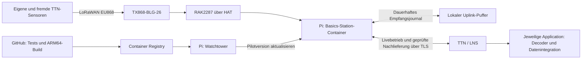

# LoRaWAN-Gateway: Implementierungs- und Betriebsplan

Stand: 29.10.2026. Status: Pilot auf dem Pi installiert; Hardwareabnahme läuft.
Aktuelle Testergebnisse stehen im [Betriebsnachweis](betriebsnachweis.md). Annahme: Standort Deutschland, EU868, Internet per Ethernet/PoE.

Die [Hardwarefähigkeiten und der Vergleich zum Heltec-Testgateway](hardware-faehigkeiten.md)
erklären den vollwertigen Achtkanalbetrieb, seine Grenzen und die weiterhin
separat zu prüfenden Single-Channel-Einstellungen bestehender Sensor-Firmware.

Die [Recherche vorhandener Container und Projekte](vorhandene-projekte.md)
führt zum vorhandenen Basics-Station-Container als Grundlage. Der Nutzer hat
GitHub Actions → GHCR → Watchtower als Updatepfad gewählt; balena und ein eigener
Updater sind für den Grundaufbau nicht vorgesehen. Konkrete Einrichtung und
Grenzen stehen in [hardware/gateway/README.md](../../hardware/gateway/README.md).
Store-and-forward ist als SQLite-Journal mit lokalem LNS-Zwischenprozess implementiert;
die vollständige Hardware-/TTN-Abnahme bleibt verbindliches Ziel.

## 1. Ziel und Entscheidungen

Das Gateway besteht aus Raspberry Pi 4, RAK2287 mit Raspberry-Pi-HAT,
PoE-HAT und TX868-BLG-26-Außenantenne. Zunächst verbindet es eigene und fremde
TTN-Endgeräte mit The Things Network. Änderungen an der Gateway-Anwendung
werden nach erfolgreicher CI und Freigabe eines Releases automatisch vom Pi
abgerufen, geprüft und aktiviert. Bei einer fehlerhaften Version erfolgt ein
lokaler Rücksprung auf die letzte funktionierende Version.
Store-and-forward ist Bestandteil des Zielumfangs: Bei Ausfall der
Internet-/LNS-Verbindung bleibt der Funkempfang aktiv, empfangene Uplinks werden
dauerhaft lokal gepuffert und nach Wiederverbindung kontrolliert nachgeliefert.
Die TTN-seitige Verarbeitung verspäteter Pakete ist vor der Festlegung des
Produktions-Forwarders nachzuweisen (Abschnitt 3.1).

Vorgeschlagene Entscheidungen:

- Raspberry Pi OS Lite in 64 Bit als Host; konkrete Version beim Hardwaretest festlegen.
- Docker Engine und Compose; Images für `linux/arm64`.
- Ein einziger Funkprozess mit Zugriff auf den Konzentrator; Basics Station
  ist die bevorzugte Ausgangsbasis, vorbehaltlich des Store-and-forward-Nachweises.
- RAKWireless/basicstation als Ausgangsbasis evaluieren; geprüften Quellstand
  und Abhängigkeiten fixieren. Vorhandene Funk-/LNS-Implementierung soweit
  möglich weiterverwenden; Offline-Erweiterungen anhand des Nachweises auswählen.
- Persistenter, applicationunabhängiger Uplink-Puffer außerhalb des
  Container-Dateisystems; nötige Erweiterungen am Forwarder gezielt entwickeln.
- TTN zuerst, ChirpStack später auf einem zentralen Server.
- Watchtower mit festem Scope und expliziter Containerfreigabe auf dem Pi;
  vorhandener gepflegter Fork statt archiviertem Ursprungsprojekt.
- Gepinnte Upstream-Images und GHCR-Pilotkanal plus feste Commit-Tags.
  Ein hostseitiger Rollback-Dienst ist implementiert; Signaturprüfung bei Aktivierung
  bleibt offen.
- Automatisch ausrollen, sobald eine Version für den Standort freigegeben ist;
  ein beliebiger Code-Push ist noch keine Produktionsfreigabe.
- Host-Betriebssystem, Container-Anwendung und Sensor-Firmware haben getrennte
  Updateverfahren. Gateway-Updates aktualisieren keine Sensor-Firmware.

Basics Station wird von The Things Stack als bevorzugtes Gateway-Protokoll
empfohlen [1]. Das RAK-Docker-Projekt nennt RAK2287, SX1302 und ARM64 als
unterstützte Kombination [2]. Die tatsächliche HAT-/OS-Kombination bleibt zu testen.

## 2. TTN, Community und Grenzen

Ein Gateway gehört keiner einzelnen Sensor-Application. Es empfängt passende
LoRaWAN-Funkpakete und leitet sie an das angeschlossene Netzwerk weiter.
Eigene Sensoren werden separat als Endgeräte mit individuellen OTAA-Zugangsdaten
in einer TTN-Application registriert. Andere Entwickler können mit ihren eigenen
TTN-Applications dieselbe Funkabdeckung nutzen; ihre Application-Schlüssel
benötigen wir nicht. Das Gateway liefert uns dadurch keinen Zugriff auf deren
entschlüsselte Anwendungsdaten. Die öffentliche Community-Abdeckung entspricht
dem TTN-Modell [3].

Die Annahme „zehn Sensoren pro Application“ ist anhand der geprüften öffentlichen
Quellen nicht bestätigt. Vor Inbetriebnahme tatsächliche Kontingente und
Nutzungsbedingungen im vorgesehenen Konto prüfen. Nicht allein wegen dieser
vermuteten Grenze zu ChirpStack migrieren.

Explizit dokumentiert sind bei TTN Sandbox 30 Sekunden Uplink-Airtime pro Gerät
und Tag sowie zehn Downlinks pro Gerät und Tag [4]. Deshalb:

- Unbestätigte Uplinks für normale Messwerte vorsehen; ACKs benötigen Downlinks.
- Payload, Datenrate und Intervall gemeinsam dimensionieren; Join-Vorgänge und
  Wiederholungen berücksichtigen und Reserve einplanen.
- Airtime und Sendeverhalten in der jeweiligen Sensor-Application planen.
  Ein Intervall von fünf Minuten ist bei hohen Spreading Factors nicht automatisch
  TTN-tauglich; das Gateway benötigt dafür keinen sensorspezifischen Decoder.
- Funkkanäle und gesetzliche Sendezeit-/Leistungsgrenzen gelten auch im eigenen Netz.

Mehrere Kilometer Reichweite sind ein zu messendes Projektziel. Gebäudehöhe,
Sichtverbindung, Bebauung, Antennen an beiden Enden, Kabelverluste und Störungen
entscheiden über die tatsächlich nutzbare Abdeckung.

## 3. Architektur



Im Zielausbau laufen auf dem Pi Forwarder mit persistentem Uplink-Puffer, Watchtower und
Betriebsüberwachung. Kein lokaler Network Server und keine Datenbank für
entschlüsselte Sensormesswerte. Der Puffer speichert Funkframes einschließlich
ihrer Empfangsmetadaten und bleibt unabhängig von Sensorformaten und Applications.

Payload-Formatter, Application-Zugangsdaten, Webhooks und Messwertverarbeitung
gehören zur jeweiligen Application hinter dem Network Server. Der vorhandene
Formatter unter `hardware/sensor-node/rak3112/v1/payload-formatter.js` ist keine
Gateway-Komponente. Er wird weder ins Gateway-Image eingebaut noch dort
ausgeführt; Änderungen daran lösen keinen Gateway-Build oder -Rollout aus.
Das Gateway benötigt keine AppKeys oder AppSKeys und entschlüsselt keine
Anwendungsdaten. Auch fremde TTN-Applications werden ohne eigene Decoder oder
Application-Allowlist am Gateway bedient, innerhalb der LNS-Netzwerkfilter.

### 3.1 Store-and-forward: Umsetzung und belastbare Grenzen

**Verbindliches Ziel:** Empfang während eines Backhaul-Ausfalls, dauerhafte
Speicherung und automatische Nachlieferung. Lokale Sicherung, Übertragung zum
LNS und Annahme durch die Application werden als getrennte Zustände bewertet.
Ein erfolgreicher Socket-Schreibvorgang belegt keine erfolgreiche Zustellung
bis zur Application. Ein Rohdatenarchiv allein erfüllt dieses Zustellziel nicht.

**Empfangspfad:** Empfangene, CRC-gültige und gemäß Netzwerkprofil zugelassene
Frames vor ihrer Weiterleitung in einem lokalen Journal sichern. Vorgesehene
Basis ist SQLite mit WAL und geeigneter Synchronisation auf einem Host-Volume.
Den tatsächlichen Verlustbereich bei Stromausfall einschließlich Datenträger-
Verhalten testen; nur dauerhaft bestätigte Schreibvorgänge als gesichert zählen.
Speichern: unveränderter LoRaWAN-Frame bzw. verlustfrei rekonstruierbare
Protokollrepräsentation, Gateway-EUI, eindeutige lokale Empfangs-ID, Frequenz,
Datenrate, RSSI/SNR, Empfangskontext, Konzentratorzeit, Boot-/Zeitdomänen-ID,
verfügbare UTC-/GNSS-Zeit mit Qualitätsangabe und Netzwerkprofil-Version.
Keine künstlich aktuellen Empfangszeiten beim Wiederabspielen erzeugen.
DevAddr ist keine global eindeutige Geräte- oder Application-Identität.

**Offlinebetrieb:** Letzten geprüften Kanalplan und Hardwarekonfiguration lokal
halten. Nach Verbindungsabbruch und nach einem Neustart ohne Internet weiter
empfangen können. Dabei Gültigkeit und Profilbindung des gespeicherten Plans
prüfen. Ein unverändertes Basics-Station-Image wird hierfür nicht als ausreichend
vorausgesetzt: Das LNS-Protokoll sieht zunächst `router_config` vom Server vor [10].
Ein bloßer WebSocket-Proxy kann ausgebliebene Funkaufzeichnungen nicht ersetzen.

**Implementierungsentscheidung:** Zuerst die gepinnte Basics-Station-Basis auf
Offlineempfang, Journal-Einhängepunkt und Wiederanlauf prüfen. Fehlende Funktionen
erfordern eine gepflegte Erweiterung am Empfangspfad einschließlich lokalem
Konfigurationsstart. Falls die Basis ungeeignet ist, den Funkprozess durch einen
geeigneten HAL-/Konzentrator-Dienst mit Queue und LNS-Adapter ersetzen. Weiterhin
genau ein Prozess auf SPI; Entscheidung mit Hardware- und TTN-Versuch treffen,
bevor das Produktionsimage festgelegt wird.

**Nachlieferung:** Nach Wiederverbindung gespeicherte Datenframes in ursprünglicher
Empfangsreihenfolge abarbeiten, mit begrenzter Rate, Backoff und fortgesetztem
Liveempfang. Liveverkehr und Rückstau so koordinieren, dass die eigene Weiterleitung
ältere Frames nicht durch neuere überholt; Auswirkungen auf Live-Latenz messen.
Empfangs-ID und Nutzdatenhash für Wiederholungsbehandlung führen, aber echte
mehrfache Funkempfänge nicht blind anhand eines Hashs zusammenwerfen.
Zustandswechsel wie `persisted`, `send_attempted`, `acceptance_unknown`,
`accepted` und `expired` dauerhaft führen. `accepted` nur mit belastbarem Beleg
der jeweiligen Gegenstelle setzen. Keine garantierte Exactly-once-Zustellung
an TTN behaupten: Die dokumentierten LNS-Uplinknachrichten enthalten keine
Ende-zu-Ende-Quittierung der Application [10]. Ohne Annahmenachweis Datensätze
nicht allein wegen erfolgreichem WebSocket-Senden löschen; begrenzte
Wiederholungen und nachvollziehbare Aufbewahrung vorsehen.

**TTN-Kompatibilität als frühe Abnahme:** Das LNS-Protokoll beschreibt Transport
und Empfangszeitkontext, garantiert aber keine beliebig späte Verarbeitung [10].
Mit vorhandener OTAA-Session Offlinephasen von 5 Minuten, 1 Stunde, 24 Stunden
und zum Abschluss 72 Stunden bei vereinbarter Last
prüfen: Annahme im Gateway Server, Network Server und einer separaten
Test-Application getrennt nachweisen. Zusätzlich Mehrgateway-Empfang, inzwischen
höhere Frame Counter, Sessionwechsel/Rejoin, Duplikate, Counterüberlauf sowie
Neustart des Konzentrators testen. Frame Counter dienen dem Replay-Schutz [11];
sie oder MIC/Session-Zuordnungen nicht umschreiben und Schutzprüfungen nicht
abschalten. Empfangsreihenfolge auf unserem Pi verhindert keine Überholung über
ein anderes Gateway. Historische Zeitstempel und ungültig gewordener
Downlink-Kontext sind ausdrücklich Teil des Versuchs.

**Zeitkritische Funkvorgänge:** Während des Ausfalls lassen sich Joins,
Bestätigungen und Class-A-Downlinks nicht nachträglich in bereits abgelaufenen
Empfangsfenstern zustellen [12]. Veraltete Join Requests nicht als nachholbaren
Join behandeln; neue Join-Versuche nach Wiederverbindung regulär verarbeiten.
Historische Downlink-Aufträge nicht später auf Funk aussenden. Gepufferte
bestätigte Uplinks können Anwendungsdaten enthalten, erhalten dadurch aber kein
nachträglich gültiges ACK im ursprünglichen Empfangsfenster.

**Kapazität:** Planungsziel zunächst 72 Stunden Offlineempfang beim gemessenen
Spitzenverkehr aller zugelassenen Geräte. Bedarf aus Frames/s × Bytes/Datensatz
× Offlinezeit plus Index-/WAL-Aufwand und Reserve bestimmen; mindestens den
doppelten gemessenen Bedarf vorsehen. Byte-, Anzahl- und Altersgrenzen festlegen,
System-/Update-Reserve separat sichern. Bei Grenzwertüberschreitung alarmieren;
älteste Datensätze nur nach dokumentierter Überlaufregel verwerfen und genaue
Verlustzähler führen. Kein unbegrenztes verlustfreies Puffern versprechen.

**Entscheidung bei TTN-Grenzen:** Wenn TTN historische Frames im geprüften Fall
nicht bis zur Application verarbeitet, ist diese Anforderung im TTN-Profil noch
nicht erfüllt. Lokale Aufzeichnung bleibt erhalten, ersetzt aber die Zustellung
nicht. Dann vor Dachbetrieb einen unterstützten Nachlieferweg bzw. eine geeignete
Network-Server-Lösung auswählen. Ein eigener quittierender Rohdaten-Empfänger
wäre eine gesonderte Option zur Sicherung, keine automatische TTN-Integration
und kein Anlass, Application-Schlüssel auf dem Gateway zu speichern.

## 4. Hardware und Standort vorab klären

### Bestätigter Planungsstand nach Hardwarefoto und Nutzerangaben

- Raspberry Pi 4 mit Raspberry Pi PoE+ HAT (R2), Herstellerteilenummer SC1022,
  Händlerartikel RP2-210220, GTIN 5056561800097.
- Das bereitgestellte Foto zeigt ein Modul mit Aufdruck `RAK2287` und `EU868`
  auf einer RAK-Trägerplatine mit Kühlkörper. Die genaue HAT-Revision und
  Schnittstellenvariante sind auf dem Foto nicht eindeutig ablesbar. Bei der
  beschriebenen Pi-HAT-Kombination ist SPI vorgesehen; am Board verifizieren.
- Das ergänzte Rückseitenfoto zeigt eine 40-polige Buchsenleiste (`J1`) und
  RAK-Beschriftung. Eine eindeutige Modell-/Revisionsnummer ist auch dort nicht
  ablesbar. Die sichtbaren Leiterplatten-/Fertigungsmarkierungen werden nicht
  als Produktrevision interpretiert. Das Foto belegt noch keine Stapelbarkeit
  mit dem PoE+ HAT und keine geprüfte GPIO-Belegung.
- Wetterbeständiges Gehäuse für den Pi am Dachstandort vorgesehen.
- Montagehöhe laut Nutzer etwa 12 m über dem Boden am Dachstandort.
  Gebäude, konkrete Befestigung und Höhe relativ zur Dachfläche bleiben für
  Standortblatt und Montageplanung festzulegen.
- Antennenkabellänge laut Nutzer etwa 5 cm. Kabeltyp und vollständige
  Steckerkette bis zur TX868-BLG-26 bleiben zu dokumentieren. Das Foto allein
  bestätigt weder die Länge noch den Typ des äußeren Steckverbinders zuverlässig.
- Stromversorgung und Internet gemeinsam über Ethernet/PoE vorgesehen.
  Switch/Injector, Gebäudenetz und dessen Zugriffsregeln sind noch nicht festgelegt.

| Punkt | Prüfung und Ergebnis |
| --- | --- |
| RAK2287 | RAK2287 EU868 im Foto bestätigt; SPI-Ausführung am Board und SKU dokumentieren. |
| RAK-HAT | Modell und Revision, Schaltplan, Reset-/Power-GPIO, SPI-Gerät und GNSS-Anbindung aufnehmen. |
| PoE-HAT | Raspberry Pi PoE+ HAT R2 / SC1022 festgelegt; 802.3at-Versorgung und Kombination mit RAK-HAT prüfen. |
| Mechanik | Stapelbarkeit, Abstandshalter, Durchführungen, zugängliche Anschlüsse und Lüfterfreiraum prüfen. |
| Versorgung | Pi, Konzentrator und Lüfter unter Last prüfen; Unterspannung und thermische Drosselung erfassen. |
| Datenträger | Geeignete High-Endurance-SD oder getestete SSD wählen; Ersatzmedium vorbereiten. |
| Antenne | TX868-BLG-26, vertikal montiert, außerhalb abschirmender Bauteile. |
| HF-Leitung | Etwa 5 cm laut Nutzer; 50-Ohm-Kabeltyp, passende Gegenstecker und Gesamtverluste einschließlich Adapter dokumentieren. |
| Dachstandort | Etwa 12 m über Boden bestätigt; konkrete Befestigung, freie Sicht, Kabelführung, Wetterschutz und Wartungszugang festhalten. |
| Gebäudeschutz | Erdung, Potentialausgleich und Überspannungsschutz mit Gebäudeverantwortlichen/Fachbetrieb abstimmen. |
| Netzwerk | DHCP/Adressreservierung, DNS, Uhrzeitsynchronisation und zulässige ausgehende Verbindungen prüfen. |

Das RAK2287-Pi-HAT ist laut Hersteller nur für SPI-Versionen vorgesehen [5].
Bei HATs keine GPIO-Belegung oder Stapelbarkeit aus dem Produktnamen ableiten.
LoRa- und gegebenenfalls GNSS-Antennenanschluss eindeutig unterscheiden.

### Konsequenzen für Versorgung, Montage und Gehäuse

Das gewählte PoE+ HAT unterstützt den Pi 4. Die aktuelle Herstellerangabe nennt
IEEE 802.3at, 5 V/4 A Ausgang und einen 25-mm-Lüfter [9]. Deshalb einen aktiven
802.3at-PoE+-Switch oder entsprechenden Injector vorsehen und das gesamte
Leistungsbudget unter Last messen. Keine Versorgung über einen passiven
PoE-Adapter planen. Ein Injector speist Strom ein, benötigt aber zusätzlich
einen bestehenden Ethernet-Uplink zum Router bzw. Gebäudenetz.

Für zwei HATs einen mechanischen Probeaufbau vorsehen: Der PoE+ HAT benötigt
den 40-Pin-Anschluss und den separaten 4-Pin-PoE-Anschluss des Pi. Ein einfacher
40-Pin-Verlängerer allein löst daher nicht jede Stapelreihenfolge. Prüfen, ob
geeignete durchgeführte Header/Adapter erforderlich sind, ob das RAK-Board
Bauteile berührt und ob Luft am Lüfter und RAK-Kühlkörper vorbeiströmen kann.
Die konkrete Stapelreihenfolge erst nach diesem Test festlegen.

Der Hersteller spezifiziert für das PoE+ HAT einen Betriebsbereich von
0 °C bis +50 °C [9]. Ein wetterbeständiges Gehäuse stellt diesen Bereich nicht
automatisch sicher: Frost, Sonneneinstrahlung, Eigenwärme und Kondensation
in die Auslegung aufnehmen. Der interne Lüfter bewegt zunächst nur Gehäuseluft.
Vor Dachfreigabe Innenraumtemperatur und Feuchte unter realistischen Bedingungen
erfassen und bei Bedarf Verschattung, Wärmeabfuhr, Druckausgleich oder eine
geregelte Heizung dimensionieren. Ein erfolgreicher Sommer-Dauerlauf weist
keinen Betrieb bei Frost nach. Auch den Kaltstart berücksichtigen, wenn das
Gehäuse nach Stromausfall unter 0 °C ausgekühlt ist.

Die kurze HF-Leitung ist für geringe Kabelverluste günstig; Antenne mechanisch
am Gehäuse/Mast abfangen und das empfindliche Modul-Pigtail zugentlasten.
Eine wetterfeste Antennendurchführung und die Ethernet-Einführung mit Dichtung
und Tropfschleife planen. Ein Metallgehäuse erfordert eine außenliegende Antenne.
Beim Überspannungsschutz die vollständige HF- und Ethernet-Strecke berücksichtigen;
zusätzliche Bauteile können die bisher angenommene Kabellänge verändern.

Für die TX868-BLG-26 nennt Ebyte 868 MHz, 3 dBi, 50 Ohm und N-J/N-Stecker [6].
Bei der vorhandenen Antenne Typenschild und Ausführung gegenprüfen. Das Modell
bezeichnet keine 26-dBi-Antenne. Kurze HF-Leitungen bevorzugen; bei Bedarf den Pi
nahe der Antenne und die längere Strecke per Ethernet/PoE anbinden.

Die erlaubte Sendeleistung vor Inbetriebnahme anhand des konkreten Kanalplans
und der geltenden deutschen Frequenzzuteilung prüfen. Antennengewinn und gesamte
Leitungsverluste in die Leistungsbilanz einbeziehen. Nicht die maximale
Hardwareleistung des RAK pauschal konfigurieren. Bei Angaben zwischen ERP und
EIRP sauber umrechnen.

## 5. Host und Forwarder einrichten

1. Reproduzierbare Installationsanleitung und Inventar für genau diesen Pi erstellen.
2. 64-Bit-OS installieren, SSH-Schlüssel und eindeutigen Hostnamen provisionieren.
3. SPI sowie nur tatsächlich benötigte weitere Schnittstellen aktivieren.
4. Docker/Compose installieren; Versionsstände dokumentieren.
5. Fernwartung über ausgehend aufgebautes VPN einrichten und nach Reboot prüfen.
   Die konkrete Lösung anhand vorhandener Infrastruktur wählen.
6. Stabile Gateway-EUI aus vorhandener Herstelleridentität bzw. sauber
   dokumentierter Ableitung bestimmen und dauerhaft fixieren.
7. TTN-Gateway im europäischen Cluster registrieren, EU868-Frequenzplan,
   Standort und Antennendaten passend konfigurieren.
8. Gateway-spezifischen LNS-Schlüssel mit minimalen Rechten lokal provisionieren.
9. Basics Station mit festem Modell, Schnittstelle, SPI-Gerät und verifizierten
   GPIO-Werten starten. Kein zweiter Forwarder darf parallel auf SPI zugreifen.
10. TTN-Verbindung, OTAA-Join und Uplink-/Downlink-Transport mit einer separaten
    Test-Application prüfen; danach Store-and-forward gemäß Abschnitt 3.1 abnehmen.

LNS verwendet bei The Things Stack `wss://<server-address>:8887`; CUPS verwendet
HTTPS auf Port 443 [7]. Den konkreten Endpunkt aus dem verwendeten TTN-Cluster
übernehmen. Netzwerkregeln müssen zusätzlich Registry, Release-Download, DNS,
Zeitabgleich und Fernwartung erlauben; ein funktionierender Browser allein
belegt keine funktionierende LNS-Verbindung.

Den Container mit gezielt durchgereichten SPI-/GPIO-Geräten betreiben, soweit
die getestete Implementierung das unterstützt. Dauerhaftes `privileged: true`
und Host-Netzwerk nicht voraussetzen. Die EUI bleibt auch bei neu erstelltem
Container gleich. Schreibzugriff auf Konfiguration und Dateisystem begrenzen;
benötigte Laufzeitverzeichnisse ausdrücklich vorsehen.

LNS-Schlüssel und VPN-Zugangsdaten bleiben außerhalb von Git und Image, mit
beschränkten Dateirechten. Logs dürfen keine Schlüssel enthalten. CUPS kann
später die LNS-Konfiguration verwalten; es ersetzt nicht automatisch unser
Container- oder Host-Updateverfahren.

## 6. Automatische Updates über GHCR und Watchtower

Der erste Grundaufbau implementiert den gewählten Pfad ohne neue IoT-Plattform:
GitHub Actions prüft und baut ARM64, veröffentlicht das geprüfte Image auf GHCR,
Watchtower auf dem Pi ersetzt ausschließlich den freigegebenen Gateway-Container.
Upstream- und Watchtower-Basis sind per Digest fixiert. Die CI erstellt feste
`sha-<commit>`-Tags und einen beweglichen `pilot`-Tag für den zugänglichen Testaufbau.
Es gibt noch keinen Dach-/Produktionskanal.

TTN-Zugangsdaten werden als `TC_KEY` in der lokalen, ignorierten `.env` mit
Dateirechten 600 abgelegt und ausschließlich an den Funkcontainer übergeben.
Keine zusätzliche LNS-Schlüsseldatei ist nötig. Der Key ist dadurch in
Container-Metadaten und aufgelöster Compose-Konfiguration sichtbar; normale
Validierung mit `docker compose config --quiet`. Generierte Konfiguration wird
pro Start neu erstellt. Ein optionales
Compose-Overlay bindet ausschließlich lesende Registry-Zugangsdaten für private
GHCR-Pakete ein. EUI bleibt explizit festgelegt; kein Host-Netzwerk erforderlich.
Compose-/Host-Konfigurationsänderungen müssen gesondert übertragen werden.

Watchtower wird durch einen hostseitigen Guardian ergänzt. Der Healthcheck prüft
Bridge-Lebenszeichen, lokale Station-Verbindung und protokollierten HAL-Start.
Der Guardian behält ein gutes Image lokal und pausiert nach einem Rücksprung
weitere Updates. Hardwareempfang, defekten Kandidaten und Stromausfälle vor
Dachfreigabe separat testen; Container-Liveness allein belegt keinen Funkempfang.

Der persistente Funkpuffer liegt außerhalb des austauschbaren Containers und muss
Updates/Rollbacks einschließlich Schemawechsel überstehen. Kein
Löschen der Queue beim Versionswechsel. Ein erfolgreiches CI-/GHCR-Ergebnis
ersetzt weder diese Abnahme noch einen Hardware-/TTN-Test.

## 7. CI und Repository-Struktur

Angelegter Grundaufbau und vorgesehene Erweiterung:

```text
hardware/gateway/
  Dockerfile                  # gepinnte vorhandene Basics Station + Startwrapper
  compose.yml                 # Gateway und scoped Watchtower
  compose.registry-auth.yml   # optionaler privater GHCR-Lesezugang
  .env.example                # Parameter und leerer TC_KEY-Platzhalter
  bridge/                     # LNS-Brücke und SQLite-Empfangsjournal
  scripts/                    # Start, Healthcheck und hostseitiger Guardian
  tests/                      # Konfiguration, Offlinebetrieb, Replay, Rücksprung
  README.md
.github/workflows/gateway.yml # ARM64-Prüfung und Pilotveröffentlichung
docs/gateway/
```

Die Queue liegt in `hardware/gateway/bridge/spool.py`; persistenter Zustand in `hardware/gateway/state/`
und hostseitige Image-Metadaten unter `/var/lib/kamue-gateway-guardian/`.
Beides gehört nicht ins Repository.

PR-Prüfungen: Konfiguration validieren, Secrets ausschließen, Skripte prüfen,
Im Grundaufbau Fehlerfälle der Konfiguration und ARM64-Image prüfen;
Queue- und Rollback-Zustandswechsel mit deren späterer Implementierung testen. Bei Nutzung
von Shell ShellCheck, bei Python passende Lint- und Unit-Tests vorsehen.
Release-Build: getesteten Commit bauen, unveränderlichen Digest veröffentlichen,
zunächst als `pilot` und festen Commit-Tag veröffentlichen.

Nach bestandenem Hardwaretest exakt denselben Digest in den stabilen Kanal
übernehmen. Keine erneute Kompilierung zwischen Test und Produktion.
Bei nur einem Pi zunächst am zugänglichen Pi testen; für spätere Releases nach
Dachmontage ist ein zweites gleich ausgestattetes Testgerät sinnvoll.
Emulierte ARM64-Builds ersetzen keine Prüfung von SPI und GPIO.

Der Gateway-Workflow reagiert gezielt auf `hardware/gateway/**`, seinen eigenen Pfad und
gegebenenfalls explizit genutzte gemeinsame Builddateien. Gateway-Images erhalten
eigene Registry-Namen und Releasekanäle, unabhängig vom VPS-Stack.

## 8. Betriebsüberwachung und Wartung

Erfassen: aktive Version/Digest, letzter erfolgreicher Updatecheck, letzter
Rollback, Container-Neustarts, Konzentrator-/LNS-Zustand, letzte Funkaktivität,
CPU-Temperatur, Unterspannung, Drosselung, Speicherplatz und Host-Uptime.
Zusätzlich Queue-Belegung, Alter des ältesten Frames, Schreiblatenz/-fehler,
Wiederholungen, unbekannte Annahmezustände, Nachlieferrate und verworfene Frames
erfassen. Bei ausbleibendem Abbau des Rückstaus und drohendem Überlauf alarmieren.
Verfügbare Forwarder-Metriken prüfen; nicht von vollständigen RX-/TX-Zählern
in jedem Backend ausgehen. Betriebsdaten enthalten keine entschlüsselten
fremden Payloads oder Zugangsschlüssel.

Ein externer Monitor erkennt fehlende Lebenszeichen, da ein ausgefallener Pi
seinen eigenen Ausfall nicht melden kann. Vorgeschlagene Alarmgrenzen:
mehrere Minuten ohne LNS-Verbindung, etwa zehn Minuten ohne Host-Lebenszeichen,
wiederholte Abstürze sowie jeder fehlgeschlagene Rücksprung. Werte im Pilotbetrieb
anpassen; fehlende Funkaktivität separat bewerten.

Logs mit Größen- und Aufbewahrungsgrenzen konfigurieren. Hardware-Watchdog und
gegebenenfalls ferngesteuerten PoE-Port testen. Watchdog nur bei lokalen Hängern
einsetzen, nicht bei jeder TTN-Störung den Host neu starten.

Container automatisch aktualisieren; Host-/Kernel-/Bootloader-Updates zunächst
in einem getrennten kontrollierten Wartungsfenster mit VPN und Rückfallplan.
Falls später auch diese vollständig automatisch und ausfallsicher sein sollen,
A/B-fähiges Betriebssystem-/OTA-Verfahren gesondert auswählen. Einfache
Paketupdates bieten keinen gleichwertigen Rücksprung.

## 9. Umsetzung in prüfbaren Etappen

| Etappe | Arbeitsergebnis | Abnahmekriterium |
| --- | --- | --- |
| A: Inventar | Hardwareliste, GPIO-/Versorgungsplan, Standort- und Netzwerkprofil | Varianten und HAT-Kombination geklärt; kein offener Versorgungskonflikt. |
| B: Grundbetrieb | Funkprozess und TTN | OTAA-Join, Uplink und geplanter Testdownlink funktionieren mit unabhängiger Test-Application. |
| B1: Store-and-forward | Persistente Queue, Offlineempfang und geprüfter Nachlieferweg | Ausfall, Offline-Neustart und Wiederanlauf geprüft; verspätete Daten erreichen die Test-Application im vereinbarten Testumfang. TTN-Grenzen sind vor Wahl des Produktionsimages geklärt. |
| C: Reproduzierbarkeit | Provisionierung, Compose und gepinntes ARM64-Image | Frisches Medium lässt sich nach Anleitung auf denselben Stand bringen. |
| D: Fernupdates | Signierte Releases, Updater und Rücksprung | Erfolgsfall und absichtlich fehlerhafter Kandidat ohne Vor-Ort-Eingriff getestet. |
| E: Dauerlauf | Monitoring, VPN, Loggrenzen, Strom-/Netzausfalltests | Mindestens sieben Tage stabil; Neustarts und Wiederverbindung nachgewiesen. |
| F: Dachbetrieb | Geprüfte Montage und dokumentierte Funkmessungen | Standortfreigabe, Schutzmaßnahmen, Fernzugriff und Update nach Montage geprüft. |
| G: Eigener Network Server | Separater ChirpStack-Pilot | Join, Datenpfad, Downlink, Backup und Rückkehr zum TTN-Profil nachgewiesen. |

Grobe Aufwandsschätzung ohne Store-and-forward: ungefähr sechs bis zehn aktive
Arbeitstage plus Dauerlauf und Montagekoordination. Für B1 zunächst zwei bis vier
aktive Tage für Machbarkeit und Prototyp reservieren. Aufwand für produktive
Queue, Offline-Forwarder und Nachlieferung danach anhand der Befunde schätzen;
die bisherige Gesamtschätzung gilt damit nicht mehr für den vollständigen Umfang.
ChirpStack separat planen.

## 10. Verbindliche Tests vor schwer zugänglicher Montage

- Cold Boot, Warmstart und Container-Neuerstellung erhalten dieselbe Gateway-EUI.
- Referenzsensor führt OTAA-Join aus; Uplink und zulässiger Testdownlink funktionieren.
- Zwei unabhängige TTN-Test-Applications mit unterschiedlichen Payloadformaten
  werden ohne Änderung am Gateway bedient. Keine Decoder, Application-Schlüssel
  oder Abhängigkeiten vom bestehenden Sensor-Backend im Gateway-Image.
- Netzwerkunterbrechung und TTN-Nichterreichbarkeit führen nach Wiederkehr zur
  Verbindung, ohne Reboot-Schleifen. Im vereinbarten Last-/Zeitbereich werden
  dauerhaft gesicherte Uplinks nachgeliefert; Annahme durch die Test-Application
  getrennt von bloßer Übertragung belegen.
- Empfang und Queue funktionieren nach Kaltstart ohne Internet mit gespeichertem
  Kanalplan; Reboot und Stromausfall erhalten bereits dauerhaft bestätigte Frames.
- Nachlieferung mit parallel laufendem Liveverkehr, Mehrgateway-Empfang,
  Sessionwechsel und Zeit-/Countergrenzen gemäß Abschnitt 3.1 prüfen.
- Verbindungsabbruch unmittelbar nach Senden verursacht keinen stillen Datenverlust;
  unbekannte Annahme und mögliche Duplikate bleiben nachvollziehbar.
- Queue-Alter/-Größe begrenzen; Überlauf alarmiert und zählt verworfene Frames.
  Warteschlange übersteht Update und Rollback einschließlich Schemakompatibilität.
- Veraltete Joins/Downlinks werden nicht als regulär nachgeholt ausgegeben.
- Gültiges Update gelingt; falsche Signatur, falsches Profil, inkompatible
  Hostversion und unvollständiger Download werden vor Aktivierung abgewiesen.
- Abstürzendes Image, falsche SPI-/GPIO-Konfiguration und defekte LNS-Konfiguration
  lösen den vorgesehenen Rücksprung aus.
- Stromausfall in den einzelnen Updatephasen hinterlässt einen startfähigen Stand.
- Volles Dateisystem und fehlende Registry verhindern keinen Betrieb der Altversion.
- Ruhiges Funkfeld löst keinen falschen Rollback aus.
- VPN funktioniert nach Stromausfall; externer Monitor erkennt Totalausfall.
- Versorgung und Temperatur bleiben im realen Gehäuse unter Last unauffällig.
- PoE+ HAT und RAK-HAT passen ohne Kontakt zu Bauteilen zusammen; PoE-Anschluss,
  GPIO/SPI und Lüfter bleiben funktionsfähig. Innenraumtemperatur bleibt im
  spezifizierten Bereich; Frost-/Kaltstartkonzept und Kondensationsschutz sind geklärt.
- Reichweitentest protokolliert Standort, Entfernung, RSSI, SNR, Datenrate und
  Paketverlustrate mit bekanntem Sendeplan; erfolgreicher Downlink separat prüfen.

## 11. Späterer ChirpStack-Ausbau

Gemeint ist ChirpStack, der offene LoRaWAN Network Server. Vorschlag: zentral
auf dem VPS bzw. einem eigenen Server betreiben. Der Pi behält Basics Station.
Der neue Pfad lautet:

```text
Pi/Basics Station → TLS → ChirpStack Gateway Bridge → MQTT → ChirpStack
                                                          ↓
                                             Backend-Integrationsadapter
```

ChirpStack Gateway Bridge unterstützt Basics Station einschließlich TLS und
Clientzertifikaten [8]. Serverkomponenten, MQTT, PostgreSQL und Redis anhand
der dann verwendeten ChirpStack-Version festlegen, privat vernetzen und sichern.
Kanalplan und Downlink-Konfiguration ausdrücklich testen. Credentials werden
nicht mit dem bisherigen TTN-Schlüssel weiterverwendet.

Der Wechsel erfordert eine separate Migration von Endgeräten und Applications:
Geräteprofile und Schlüssel auf der Serverseite provisionieren, neue OTAA-Joins
durchführen und die jeweiligen Decoder/Integrationen dort einrichten. Diese
Arbeiten sind keine Gateway-Komponenten und bleiben vom Gateway-Release getrennt.
Store-and-forward für ChirpStack erneut bis zur Test-Application prüfen;
gepufferte Frames an ihr ursprüngliches Netzwerkprofil binden und nicht bei
Profilwechsel ungeprüft in ein anderes Netz einspeisen.

Zunächst ein separates Gateway-Profil mit genau einem aktiven LNS verwenden.
Ein einfacher Wechsel zu ChirpStack nimmt diesem Gateway seine bisherige
TTN-Anbindung. Soll die öffentliche TTN-Abdeckung erhalten bleiben, bevorzugt ein
zweites Gateway einplanen. Parallelweiterleitung oder Roaming wären ein eigenes
Projekt mit abgestimmter Downlink-Steuerung; zwei Forwarder auf derselben
SPI-Hardware sind keine Lösung. Keine automatische Umschaltung bei TTN-Ausfall:
Die Sensoren können nicht allein dadurch spontan in einem anderen Netz arbeiten.

ChirpStack beseitigt Abhängigkeiten von TTN-Kontingenten, bringt aber Betrieb,
Sicherung, Updates und Wiederherstellung des Network Servers in unsere Verantwortung.

## 12. Noch benötigte Angaben

Die Planung kann ohne diese Angaben stehen; die konkrete Hardwarekonfiguration
und Dachfreigabe hängen davon ab:

1. Genaue Revision des RAK-HAT und Bestätigung der SPI-Ausführung am Board;
   PoE+ HAT R2 / SC1022 und RAK2287 EU868 sind bereits erfasst.
2. Konkreter Standort, Befestigung und Gehäusemodell inklusive
   Temperatur-/Kondensationskonzept; etwa 12 m über Boden und ein
   wetterbeständiges Gehäuse sind als Vorgaben erfasst.
3. Kabeltyp und Steckerkette der angegebenen etwa 5 cm langen Antennenleitung.
4. Internetzugang: verwaltetes Gebäudenetz, eigene Firewall, PoE-Switch/Injector,
   Einschränkungen und Möglichkeit eines VPN.
5. Vorhandenes TTN-Konto, Application und Gateway-Registrierung sowie darin
   tatsächlich sichtbare Kontingente; keine Schlüssel im Chat oder Git ablegen.
6. Gewünschte Releasepolitik: vorgeschlagen sind automatisch installierte,
   vorher freigegebene stabile Releases mit Testkanal.
7. Soll TTN-Community-Abdeckung später parallel zu ChirpStack erhalten bleiben?
8. Offlinezeit und erwartetes Verkehrsaufkommen für die endgültige Queue-Größe;
   zunächst gelten 72 Stunden bei gemessener Spitzenlast als Planungsziel.

## Quellen

Geprüft am 28.10.2026. Herstellerunterstützung ist noch kein Nachweis des
Betriebs auf unserer konkreten Hardware.

[1] The Things Stack: Packet Forwarders
https://www.thethingsindustries.com/docs/hardware/gateways/concepts/packet-forwarder/

[2] RAKWireless: Basics Station für Docker, Hardware/Architekturen und Gerätezugriff
https://github.com/RAKWireless/basicstation

[3] The Things Network: Community-Abdeckung und Applications
https://www.thethingsnetwork.org/

[4] The Things Network: Duty Cycle und Fair Use Policy
https://www.thethingsnetwork.org/docs/lorawan/duty-cycle/

[5] RAKWireless: RAK2287/RAK5146 Pi HAT, SPI-Kompatibilität
https://store.rakwireless.com/collections/wishat/products/rak2287-pi-hat

[6] Ebyte: TX868-BLG-26, technische Daten
https://www.cdebyte.com/products/TX868-BLG-26

[7] The Things Stack: Gateway-Endpunkte
https://www.thethingsindustries.com/docs/hardware/gateways/troubleshooting/

[8] ChirpStack Gateway Bridge: Basics Station Backend
https://www.chirpstack.io/docs/chirpstack-gateway-bridge/backends/basics-station.html

[9] Raspberry Pi: PoE+ HAT, Kompatibilität, Anschluss und aktuelle Spezifikation
https://www.raspberrypi.com/products/poe-plus-hat/
https://datasheets.raspberrypi.com/poe/poe-plus-hat-product-brief.pdf

[10] Semtech: LNS-Protokoll, router_config, Uplinknachrichten und Empfangskontext
https://doc.sm.tc/station/tcproto.html

[11] The Things Stack: Frame Counter und Replay-Schutz
https://www.thethingsindustries.com/docs/devices/best-practices/

[12] The Things Stack: Gerätefehler, Join-/Downlink-Timing und Backhaul-Latenz
https://www.thethingsindustries.com/docs/hardware/devices/troubleshooting/
