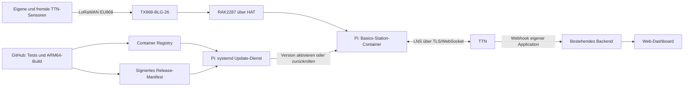

# LoRaWAN-Gateway: Implementierungs- und Betriebsplan

Stand: 28.10.2026. Status: Plan, noch keine Gateway-Software implementiert oder
auf Hardware geprüft. Annahme: Standort Deutschland, EU868, Internet per Ethernet/PoE.

## 1. Ziel und Entscheidungen

Das Gateway besteht aus Raspberry Pi 4, RAK2287 mit Raspberry-Pi-HAT,
PoE-HAT und TX868-BLG-26-Außenantenne. Zunächst verbindet es eigene und fremde
TTN-Endgeräte mit The Things Network. Änderungen an der Gateway-Anwendung
werden nach erfolgreicher CI und Freigabe eines Releases automatisch vom Pi
abgerufen, geprüft und aktiviert. Bei einer fehlerhaften Version erfolgt ein
lokaler Rücksprung auf die letzte funktionierende Version.

Vorgeschlagene Entscheidungen:

- Raspberry Pi OS Lite in 64 Bit als Host; konkrete Version beim Hardwaretest festlegen.
- Docker Engine und Compose; Images für `linux/arm64`.
- LoRa Basics Station als einziger Prozess mit Zugriff auf den Konzentrator.
- RAKWireless/basicstation als Ausgangsbasis evaluieren; geprüften Quellstand
  und Abhängigkeiten fixieren, statt einen eigenen Funk-Forwarder zu entwickeln.
- TTN zuerst, ChirpStack später auf einem zentralen Server.
- Eigener kleiner Update-Dienst auf dem Host, gestartet durch systemd.
- Versionierte, signierte Release-Manifeste und Images mit festem Digest.
- Automatisch ausrollen, sobald eine Version für den Standort freigegeben ist;
  ein beliebiger Code-Push ist noch keine Produktionsfreigabe.
- Host-Betriebssystem, Container-Anwendung und Sensor-Firmware haben getrennte
  Updateverfahren. Gateway-Updates aktualisieren keine Sensor-Firmware.

Basics Station wird von The Things Stack als bevorzugtes Gateway-Protokoll
empfohlen [1]. Das RAK-Docker-Projekt nennt RAK2287, SX1302 und ARM64 als
unterstützte Kombination [2]. Die tatsächliche HAT-/OS-Kombination bleibt zu testen.

## 2. TTN, Community und Grenzen

Ein Gateway gehört keiner einzelnen Sensor-Application. Es empfängt passende
LoRaWAN-Funkpakete und leitet sie an das angeschlossene Netzwerk weiter.
Eigene Sensoren werden separat als Endgeräte mit individuellen OTAA-Zugangsdaten
in einer TTN-Application registriert. Andere Entwickler können mit ihren eigenen
TTN-Applications dieselbe Funkabdeckung nutzen; ihre Application-Schlüssel
benötigen wir nicht. Das Gateway liefert uns dadurch keinen Zugriff auf deren
entschlüsselte Anwendungsdaten. Die öffentliche Community-Abdeckung entspricht
dem TTN-Modell [3].

Die Annahme „zehn Sensoren pro Application“ ist anhand der geprüften öffentlichen
Quellen nicht bestätigt. Vor Inbetriebnahme tatsächliche Kontingente und
Nutzungsbedingungen im vorgesehenen Konto prüfen. Nicht allein wegen dieser
vermuteten Grenze zu ChirpStack migrieren.

Explizit dokumentiert sind bei TTN Sandbox 30 Sekunden Uplink-Airtime pro Gerät
und Tag sowie zehn Downlinks pro Gerät und Tag [4]. Deshalb:

- Unbestätigte Uplinks für normale Messwerte vorsehen; ACKs benötigen Downlinks.
- Payload, Datenrate und Intervall gemeinsam dimensionieren; Join-Vorgänge und
  Wiederholungen berücksichtigen und Reserve einplanen.
- Tatsächliche Airtime der vorhandenen RAK3112-Firmware messen. Ein Intervall
  von fünf Minuten ist bei hohen Spreading Factors nicht automatisch TTN-tauglich.
- Funkkanäle und gesetzliche Sendezeit-/Leistungsgrenzen gelten auch im eigenen Netz.

Mehrere Kilometer Reichweite sind ein zu messendes Projektziel. Gebäudehöhe,
Sichtverbindung, Bebauung, Antennen an beiden Enden, Kabelverluste und Störungen
entscheiden über die tatsächlich nutzbare Abdeckung.

## 3. Architektur



Auf dem Pi laufen zunächst nur Forwarder, Update-Dienst und eine kleine
Betriebsüberwachung. Kein lokaler Network Server und keine Messwertdatenbank.
Der Forwarder ersetzt kein dauerhaftes Store-and-forward-System: Bei einem
Internetausfall können Uplinks verloren gehen, zeitkritische Downlinks lassen
sich nicht später nachholen.

Im Repository bestehen bereits ein gemeinsamer TTN-Decoder unter
`hardware/sensor-node/rak3112/v1/payload-formatter.js` und die authentifizierte
Annahme unter `/api/v1/integrations/sensor/uplink`. Diese prüft derzeit genau eine
konfigurierte `TTN_APPLICATION_ID` und verarbeitet Messwerte idempotent.
Für das erste Gateway bleibt dieser Pfad bestehen. Fremde Applications gelangen
nicht automatisch in unsere Datenbank. Mehrere eigene Applications würden eine
separate Erweiterung der Zulassung und Zugangsdatenverwaltung benötigen.

## 4. Hardware und Standort vorab klären

| Punkt | Prüfung und Ergebnis |
| --- | --- |
| RAK2287 | EU868-/8xx-MHz-Hardware und SPI-Ausführung identifizieren; SKU dokumentieren. |
| RAK-HAT | Modell und Revision, Schaltplan, Reset-/Power-GPIO, SPI-Gerät und GNSS-Anbindung aufnehmen. |
| PoE-HAT | Modell, unterstützten PoE-Standard, Leistungsbudget und Kombination mit RAK-HAT prüfen. |
| Mechanik | Stapelbarkeit, Abstandshalter, Durchführungen, zugängliche Anschlüsse und Lüfterfreiraum prüfen. |
| Versorgung | Pi, Konzentrator und Lüfter unter Last prüfen; Unterspannung und thermische Drosselung erfassen. |
| Datenträger | Geeignete High-Endurance-SD oder getestete SSD wählen; Ersatzmedium vorbereiten. |
| Antenne | TX868-BLG-26, vertikal montiert, außerhalb abschirmender Bauteile. |
| HF-Leitung | 50-Ohm-Pigtail und Koaxleitung, passende Gegenstecker, Kabeltyp/Länge und Verluste dokumentieren. |
| Dachstandort | Montagehöhe, freie Sicht, Kabelführung, Wetterschutz und Wartungszugang festhalten. |
| Gebäudeschutz | Erdung, Potentialausgleich und Überspannungsschutz mit Gebäudeverantwortlichen/Fachbetrieb abstimmen. |
| Netzwerk | DHCP/Adressreservierung, DNS, Uhrzeitsynchronisation und zulässige ausgehende Verbindungen prüfen. |

Das RAK2287-Pi-HAT ist laut Hersteller nur für SPI-Versionen vorgesehen [5].
Bei HATs keine GPIO-Belegung oder Stapelbarkeit aus dem Produktnamen ableiten.
LoRa- und gegebenenfalls GNSS-Antennenanschluss eindeutig unterscheiden.

Für die TX868-BLG-26 nennt Ebyte 868 MHz, 3 dBi, 50 Ohm und N-J/N-Stecker [6].
Bei der vorhandenen Antenne Typenschild und Ausführung gegenprüfen. Das Modell
bezeichnet keine 26-dBi-Antenne. Kurze HF-Leitungen bevorzugen; bei Bedarf den Pi
nahe der Antenne und die längere Strecke per Ethernet/PoE anbinden.

Die erlaubte Sendeleistung vor Inbetriebnahme anhand des konkreten Kanalplans
und der geltenden deutschen Frequenzzuteilung prüfen. Antennengewinn und gesamte
Leitungsverluste in die Leistungsbilanz einbeziehen. Nicht die maximale
Hardwareleistung des RAK pauschal konfigurieren. Bei Angaben zwischen ERP und
EIRP sauber umrechnen.

## 5. Host und Forwarder einrichten

1. Reproduzierbare Installationsanleitung und Inventar für genau diesen Pi erstellen.
2. 64-Bit-OS installieren, SSH-Schlüssel und eindeutigen Hostnamen provisionieren.
3. SPI sowie nur tatsächlich benötigte weitere Schnittstellen aktivieren.
4. Docker/Compose installieren; Versionsstände dokumentieren.
5. Fernwartung über ausgehend aufgebautes VPN einrichten und nach Reboot prüfen.
   Die konkrete Lösung anhand vorhandener Infrastruktur wählen.
6. Stabile Gateway-EUI aus vorhandener Herstelleridentität bzw. sauber
   dokumentierter Ableitung bestimmen und dauerhaft fixieren.
7. TTN-Gateway im europäischen Cluster registrieren, EU868-Frequenzplan,
   Standort und Antennendaten passend konfigurieren.
8. Gateway-spezifischen LNS-Schlüssel mit minimalen Rechten lokal provisionieren.
9. Basics Station mit festem Modell, Schnittstelle, SPI-Gerät und verifizierten
   GPIO-Werten starten. Kein zweiter Forwarder darf parallel auf SPI zugreifen.
10. TTN-Verbindung, OTAA-Join und vollständigen Messwertpfad prüfen.

LNS verwendet bei The Things Stack `wss://<server-address>:8887`; CUPS verwendet
HTTPS auf Port 443 [7]. Den konkreten Endpunkt aus dem verwendeten TTN-Cluster
übernehmen. Netzwerkregeln müssen zusätzlich Registry, Release-Download, DNS,
Zeitabgleich und Fernwartung erlauben; ein funktionierender Browser allein
belegt keine funktionierende LNS-Verbindung.

Den Container mit gezielt durchgereichten SPI-/GPIO-Geräten betreiben, soweit
die getestete Implementierung das unterstützt. Dauerhaftes `privileged: true`
und Host-Netzwerk nicht voraussetzen. Die EUI bleibt auch bei neu erstelltem
Container gleich. Schreibzugriff auf Konfiguration und Dateisystem begrenzen;
benötigte Laufzeitverzeichnisse ausdrücklich vorsehen.

LNS-Schlüssel und VPN-Zugangsdaten bleiben außerhalb von Git und Image, mit
beschränkten Dateirechten. Logs dürfen keine Schlüssel enthalten. CUPS kann
später die LNS-Konfiguration verwalten; es ersetzt nicht automatisch unser
Container- oder Host-Updateverfahren.

## 6. Automatische Updates mit Rücksprung

Der Update-Dienst läuft auf dem Host, damit er auch nach einem defekten
Forwarder-Container handlungsfähig bleibt. Kein Docker-Socket im Funkcontainer.
Für ein Gateway reicht ein kleiner Dienst mit Timer; eine Flottenplattform ist
zunächst nicht erforderlich.

Ein Release besteht aus Manifest, Compose-Konfiguration und ARM64-Image.
Das Manifest enthält Version, Gateway-Profil, Image-Digest, Konfigurationshash,
minimale Host-/Updater-Version und Signatur. Ein im Host hinterlegter öffentlicher
Schlüssel prüft den freigegebenen Inhalt. Der Signaturschlüssel liegt in der
Release-Umgebung. Für private Images ausschließlich lesende Zugangsdaten nutzen.

Vorgeschlagener Ablauf:

1. systemd-Timer prüft etwa alle 15 Minuten mit zufälliger Verzögerung den
   zugeordneten Release-Kanal. Ein Wartungsfenster kann Aktivierungen begrenzen.
2. Manifest herunterladen; Signatur, Profil, Versionsfolge und Kompatibilität
   prüfen. Unerlaubte Downgrades ablehnen; freigegebene Rollbacks separat abbilden.
3. Update-Sperre setzen; ausreichend Speicher und lokale Rücksprungversion prüfen.
4. Image vollständig per Digest laden und Konfiguration vorprüfen. Während
   Download und Vorbereitung bleibt die bisherige Station aktiv.
5. Aktuelle Version und passende Konfiguration als zusammengehörigen
   Rücksprungstand sichern. Secrets nicht in Release-Artefakte kopieren.
6. Alte Station beenden, neue Version aktivieren. Es gibt eine kurze Funkpause;
   zwei Versionen dürfen den Konzentrator nicht gleichzeitig betreiben.
7. In einer zunächst zehnminütigen Prüfphase Prozessstabilität,
   Konzentratorinitialisierung, Reset-Verhalten und LNS-Verbindung prüfen.
8. Bei Erfolg den Stand atomar als funktionierend markieren und melden.
9. Bei einem lokalen Fehler alte Image-/Konfigurationskombination reaktivieren,
   erneut prüfen, Kandidaten sperren und Fehler melden.
10. Bei unklarer externer Störung den Zustand begrenzt weiter prüfen und
    diagnostizieren; ohne lokale Fehler nicht endlos zwischen Versionen wechseln.

Ein fehlender Uplink ist allein kein Fehlernachweis: In einem ruhigen Funkfeld
muss ein gesundes Gateway ohne empfangene Sensorpakete laufen können. Umgekehrt
beweist ein laufender Prozess noch keine funktionierende Funkhardware.
Ein Neustart erfolgt nicht automatisch allein durch Docker-Status `unhealthy`;
die Wiederherstellungslogik muss ausdrücklich implementiert werden.

Der Updater führt ein dauerhaftes Zustandsjournal mit Phasen wie `prepared`,
`activating`, `verifying` und `committed`. Nach Stromausfall erkennt er einen
unvollständigen Wechsel und stellt einen definierten Stand her. Downloads,
Aktivierung und Rücksprung haben Zeitlimits. Wiederholungsversuche erhalten
Backoff; eine gesperrte Version wird nicht bei jeder Prüfung erneut aktiviert.

Letztes funktionierendes Image lokal behalten. Alte Images erst nach gesicherter
Übernahme und ausreichender Reserve bereinigen. Alarm bei fehlgeschlagenem
Rollback oder verlorenem Fernzugriff. Ein Container-Rollback repariert weder
beschädigten Datenträger noch defektes Betriebssystem.

## 7. CI und Repository-Struktur

Vorgesehene neue Struktur, noch nicht angelegt:

```text
gateway/
  basicstation/       # reproduzierbarer Build und Startkonfiguration
  deploy/            # Compose und Beispielkonfiguration ohne Secrets
  updater/           # Manifestprüfung, Zustandsjournal, Aktivierung, Rollback
  provision/         # Host-Einrichtung und systemd-Units
  tests/             # Update-, Konfigurations- und Ausfalltests
  README.md
.github/workflows/gateway.yml
docs/gateway/implementierungsplan.md
```

PR-Prüfungen: Konfiguration validieren, Secrets ausschließen, Skripte prüfen,
Updater-Zustandswechsel und Fehlerfälle testen, ARM64-Image bauen. Bei Nutzung
von Shell ShellCheck, bei Python passende Lint- und Unit-Tests vorsehen.
Release-Build: getesteten Commit bauen, unveränderlichen Digest veröffentlichen,
Manifest erzeugen/signieren, zunächst dem Testkanal zuordnen.

Nach bestandenem Hardwaretest exakt denselben Digest in den stabilen Kanal
übernehmen. Keine erneute Kompilierung zwischen Test und Produktion.
Bei nur einem Pi zunächst am zugänglichen Pi testen; für spätere Releases nach
Dachmontage ist ein zweites gleich ausgestattetes Testgerät sinnvoll.
Emulierte ARM64-Builds ersetzen keine Prüfung von SPI und GPIO.

Der künftige Workflow reagiert gezielt auf `gateway/**`, seinen eigenen Pfad und
gegebenenfalls explizit genutzte gemeinsame Builddateien. Gateway-Images erhalten
eigene Registry-Namen und Releasekanäle, unabhängig vom VPS-Stack.

## 8. Betriebsüberwachung und Wartung

Erfassen: aktive Version/Digest, letzter erfolgreicher Updatecheck, letzter
Rollback, Container-Neustarts, Konzentrator-/LNS-Zustand, letzte Funkaktivität,
CPU-Temperatur, Unterspannung, Drosselung, Speicherplatz und Host-Uptime.
Verfügbare Forwarder-Metriken prüfen; nicht von vollständigen RX-/TX-Zählern
in jedem Backend ausgehen. Betriebsdaten enthalten keine entschlüsselten
fremden Payloads oder Zugangsschlüssel.

Ein externer Monitor erkennt fehlende Lebenszeichen, da ein ausgefallener Pi
seinen eigenen Ausfall nicht melden kann. Vorgeschlagene Alarmgrenzen:
mehrere Minuten ohne LNS-Verbindung, etwa zehn Minuten ohne Host-Lebenszeichen,
wiederholte Abstürze sowie jeder fehlgeschlagene Rücksprung. Werte im Pilotbetrieb
anpassen; fehlende Funkaktivität separat bewerten.

Logs mit Größen- und Aufbewahrungsgrenzen konfigurieren. Hardware-Watchdog und
gegebenenfalls ferngesteuerten PoE-Port testen. Watchdog nur bei lokalen Hängern
einsetzen, nicht bei jeder TTN-Störung den Host neu starten.

Container automatisch aktualisieren; Host-/Kernel-/Bootloader-Updates zunächst
in einem getrennten kontrollierten Wartungsfenster mit VPN und Rückfallplan.
Falls später auch diese vollständig automatisch und ausfallsicher sein sollen,
A/B-fähiges Betriebssystem-/OTA-Verfahren gesondert auswählen. Einfache
Paketupdates bieten keinen gleichwertigen Rücksprung.

## 9. Umsetzung in prüfbaren Etappen

| Etappe | Arbeitsergebnis | Abnahmekriterium |
| --- | --- | --- |
| A: Inventar | Hardwareliste, GPIO-/Versorgungsplan, Standort- und Netzwerkprofil | Varianten und HAT-Kombination geklärt; kein offener Versorgungskonflikt. |
| B: Grundbetrieb | Pi mit Basics Station und TTN | OTAA-Join, Uplink und geplanter Testdownlink funktionieren; Messwert erscheint im bestehenden Backend. |
| C: Reproduzierbarkeit | Provisionierung, Compose und gepinntes ARM64-Image | Frisches Medium lässt sich nach Anleitung auf denselben Stand bringen. |
| D: Fernupdates | Signierte Releases, Updater und Rücksprung | Erfolgsfall und absichtlich fehlerhafter Kandidat ohne Vor-Ort-Eingriff getestet. |
| E: Dauerlauf | Monitoring, VPN, Loggrenzen, Strom-/Netzausfalltests | Mindestens sieben Tage stabil; Neustarts und Wiederverbindung nachgewiesen. |
| F: Dachbetrieb | Geprüfte Montage und dokumentierte Funkmessungen | Standortfreigabe, Schutzmaßnahmen, Fernzugriff und Update nach Montage geprüft. |
| G: Eigener Network Server | Separater ChirpStack-Pilot | Join, Datenpfad, Downlink, Backup und Rückkehr zum TTN-Profil nachgewiesen. |

Grobe Aufwandsschätzung: A ein halber bis ein Tag, B/C zwei bis drei Tage,
D zwei bis vier Tage, E/F ein bis zwei aktive Tage plus Dauerlauf und
Montagekoordination. Insgesamt ungefähr sechs bis zehn aktive Arbeitstage,
mit Puffer bei unbekannten HAT-/Treiberproblemen. ChirpStack separat planen.

## 10. Verbindliche Tests vor schwer zugänglicher Montage

- Cold Boot, Warmstart und Container-Neuerstellung erhalten dieselbe Gateway-EUI.
- Referenzsensor führt OTAA-Join aus; Uplink und zulässiger Testdownlink funktionieren.
- Eigener Messwert erreicht TTN, Decoder, Backend und Dashboard.
- Zweite, getrennte TTN-Application wird über dasselbe Gateway bedient;
  deren Daten werden nicht versehentlich in unser Backend übernommen.
- Netzwerkunterbrechung und TTN-Nichterreichbarkeit führen nach Wiederkehr zur
  Verbindung, ohne Reboot-Schleifen. Paketverlust während der Unterbrechung dokumentieren.
- Gültiges Update gelingt; falsche Signatur, falsches Profil, inkompatible
  Hostversion und unvollständiger Download werden vor Aktivierung abgewiesen.
- Abstürzendes Image, falsche SPI-/GPIO-Konfiguration und defekte LNS-Konfiguration
  lösen den vorgesehenen Rücksprung aus.
- Stromausfall in den einzelnen Updatephasen hinterlässt einen startfähigen Stand.
- Volles Dateisystem und fehlende Registry verhindern keinen Betrieb der Altversion.
- Ruhiges Funkfeld löst keinen falschen Rollback aus.
- VPN funktioniert nach Stromausfall; externer Monitor erkennt Totalausfall.
- Versorgung und Temperatur bleiben im realen Gehäuse unter Last unauffällig.
- Reichweitentest protokolliert Standort, Entfernung, RSSI, SNR, Datenrate und
  Paketverlustrate mit bekanntem Sendeplan; erfolgreicher Downlink separat prüfen.

## 11. Späterer ChirpStack-Ausbau

Gemeint ist ChirpStack, der offene LoRaWAN Network Server. Vorschlag: zentral
auf dem VPS bzw. einem eigenen Server betreiben. Der Pi behält Basics Station.
Der neue Pfad lautet:

```text
Pi/Basics Station → TLS → ChirpStack Gateway Bridge → MQTT → ChirpStack
                                                          ↓
                                             Backend-Integrationsadapter
```

ChirpStack Gateway Bridge unterstützt Basics Station einschließlich TLS und
Clientzertifikaten [8]. Serverkomponenten, MQTT, PostgreSQL und Redis anhand
der dann verwendeten ChirpStack-Version festlegen, privat vernetzen und sichern.
Kanalplan und Downlink-Konfiguration ausdrücklich testen. Credentials werden
nicht mit dem bisherigen TTN-Schlüssel weiterverwendet.

Der Wechsel betrifft auch Endgeräte und Datenintegration: Geräteprofile,
LoRaWAN-Versionen und individuelle Schlüssel sicher provisionieren, neue OTAA-
Joins durchführen, Decoder übernehmen und ChirpStack-Ereignisse in das bestehende
Messwertmodell abbilden. TTN-Webhook-JSON nicht als identisch voraussetzen.
Stabile Sensoridentität über DevEUI/Zuordnung erhalten; historische IDs
`ttn-<device-id>` nicht unkontrolliert durch neue Sensoren ersetzen.

Zunächst ein separates Gateway-Profil mit genau einem aktiven LNS verwenden.
Ein einfacher Wechsel zu ChirpStack nimmt diesem Gateway seine bisherige
TTN-Anbindung. Soll die öffentliche TTN-Abdeckung erhalten bleiben, bevorzugt ein
zweites Gateway einplanen. Parallelweiterleitung oder Roaming wären ein eigenes
Projekt mit abgestimmter Downlink-Steuerung; zwei Forwarder auf derselben
SPI-Hardware sind keine Lösung. Keine automatische Umschaltung bei TTN-Ausfall:
Die Sensoren können nicht allein dadurch spontan in einem anderen Netz arbeiten.

ChirpStack beseitigt Abhängigkeiten von TTN-Kontingenten, bringt aber Betrieb,
Sicherung, Updates und Wiederherstellung des Network Servers in unsere Verantwortung.

## 12. Noch benötigte Angaben

Die Planung kann ohne diese Angaben stehen; die konkrete Hardwarekonfiguration
und Dachfreigabe hängen davon ab:

1. Exaktes Modell/Revision von RAK-HAT und PoE-HAT sowie RAK2287-Variante.
2. Standort, ungefähre Montagehöhe und wettergeschützter Platz für den Pi.
3. Vorhandenes Antennenkabel: Typ, Länge, Adapter und Anschlüsse.
4. Internetzugang: verwaltetes Gebäudenetz, eigene Firewall, PoE-Switch/Injector,
   Einschränkungen und Möglichkeit eines VPN.
5. Vorhandenes TTN-Konto, Application und Gateway-Registrierung sowie darin
   tatsächlich sichtbare Kontingente; keine Schlüssel im Chat oder Git ablegen.
6. Gewünschte Releasepolitik: vorgeschlagen sind automatisch installierte,
   vorher freigegebene stabile Releases mit Testkanal.
7. Soll TTN-Community-Abdeckung später parallel zu ChirpStack erhalten bleiben?

## Quellen

Geprüft am 28.10.2026. Herstellerunterstützung ist noch kein Nachweis des
Betriebs auf unserer konkreten Hardware.

[1] The Things Stack: Packet Forwarders
https://www.thethingsindustries.com/docs/hardware/gateways/concepts/packet-forwarder/

[2] RAKWireless: Basics Station für Docker, Hardware/Architekturen und Gerätezugriff
https://github.com/RAKWireless/basicstation

[3] The Things Network: Community-Abdeckung und Applications
https://www.thethingsnetwork.org/

[4] The Things Network: Duty Cycle und Fair Use Policy
https://www.thethingsnetwork.org/docs/lorawan/duty-cycle/

[5] RAKWireless: RAK2287/RAK5146 Pi HAT, SPI-Kompatibilität
https://store.rakwireless.com/collections/wishat/products/rak2287-pi-hat

[6] Ebyte: TX868-BLG-26, technische Daten
https://www.cdebyte.com/products/TX868-BLG-26

[7] The Things Stack: Gateway-Endpunkte
https://www.thethingsindustries.com/docs/hardware/gateways/troubleshooting/

[8] ChirpStack Gateway Bridge: Basics Station Backend
https://www.chirpstack.io/docs/chirpstack-gateway-bridge/backends/basics-station.html
