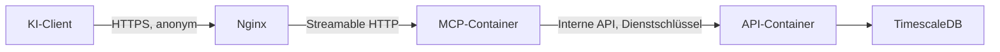

# Implementierungsplan: öffentlicher MCP-Server auf der VPS

Stand: 1. November 2026. Status: Erste Version implementiert, auf der VPS
aktiviert und öffentlich geprüft. Betriebsanleitung:
[MCP-Dokumentation](../www/vps/mcp-server/README.md). Nachweise:
[Bestandsaufnahme](evidence/mcp-inventory-2026-11-01.json) und
[Rollout mit CI-, Image- und Live-Prüfungen](evidence/mcp-rollout-2026-11-01.json).

Die erste Umsetzung liefert den allgemeinen Datenzugang, Termine/Regionalatlas,
versionierte Quellenintervalle und Diagnoseberichte. Vollständige logische
Laufbelege werden zunächst im Registry-Worker ergänzt. Andere Collector bleiben
mit ihrer vorhandenen Versuchshistorie ausdrücklich als unvollständig
instrumentiert erkennbar. Individuelle saisonale Regeln, gesonderte
Wartungsfenster und Tagesrollups sind Folgeausbaustufen; historische Belege
werden nicht erfunden. Die nachstehenden Pakete bleiben der Zielplan.

## Umsetzungsstand der ersten Version

- Öffentlich erreichbar: `https://hack-the-ried.duckdns.org/mcp`, Transport
  Streamable HTTP, anonym, ausschließlich lesend, 17 Werkzeuge.
- Katalog, Objektsuche, Messdefinitionen, letzter Messwert, Termine,
  Regionalatlas-Publikation und Archivsuche über einen echten MCP-Client geprüft.
- Siebentägiger Quellenbericht vollständig über 27 Seiten abgerufen.
- Beide öffentlichen Hostnamen unterstützen auch Protokoll `2025-11-25`.
  Interne MCP-API-Routen liefern öffentlich 404; falsche Dienstschlüssel intern 401.
- MCP besitzt keinen direkten Datenbankzugang und keine veröffentlichten Ports.
  API und MCP sind gesund; der Registry-Worker schreibt neue Laufbelege.
- Code-Stand `e992a4c3415c276850b91ad72f1ca8c93b6c1938`: alle 18
  [CI-Jobs einschließlich aller GHCR-Veröffentlichungen](https://github.com/erik-metz/hack-the-ried/actions/runs/41303595144)
  erfolgreich. VPS-Images sind auf die zugehörigen Digests festgelegt.
- Die additive Migration ist angewendet. API-Start verwendet `API_SCHEMA_MODE=validate`:
  bestehendes Schema prüfen, ohne Startup-DDL. Der optionale Quellenindex bleibt
  während unabhängiger Archivexporte zurückgestellt; gemessene Abfragen funktionieren.

Offen bleiben die oben genannten Ausbaustufen und die vollständige
Laufinstrumentierung weiterer Collector. Ein wöchentlicher KI-Auftrag ist noch
nicht eingerichtet. Er kann den öffentlichen Bericht bereits nutzen; Reparaturen
benötigen weiterhin separat autorisierte Repository- oder Betriebswerkzeuge.

## 1. Ziel und verbindliche Entscheidungen

Der MCP-Server erschließt den gesamten öffentlichen Datenbestand von HackTheRied
für lokale und andere MCP-fähige KI-Clients. Er läuft zentral als eigener
Container auf der vorhandenen VPS. Nutzer verbinden ihren Client mit einer
HTTPS-Adresse und benötigen keinen lokal betriebenen Projektserver.

Zum Kernumfang gehören:

- Alle öffentlichen Datenbereiche in `entities`, `measurement_definitions` und
  `readings`, unabhängig davon, ob sie von physischen Sensoren stammen.
- Termine, Veranstaltungen und die Datenbereiche des Regionalatlas.
- Ein auffindbarer Katalog mit Quellen, Datenbedeutung und Abfragebeispielen.
- Historische Quellenzuverlässigkeit, Diagnose und maschinenlesbare Berichte
  als Grundlage für regelmäßige Prüfungen durch eine KI.

Verbindliche Architekturentscheidungen:

1. Der öffentliche MCP-Endpunkt ist anonym und ausschließlich lesend. OAuth,
   persönliche API-Tokens und eine Nutzerverwaltung sind für diesen Umfang
   nicht erforderlich.
2. MCP verwendet Streamable HTTP über den vorhandenen HTTPS-Reverse-Proxy.
3. Der MCP-Container greift über eigene interne API-Routen auf Daten zu.
4. Die interne Verbindung erhält einen eigenen Dienstschlüssel. Bestehende
   Ingestion- und Admin-Schlüssel werden dafür nicht verwendet.
5. Der MCP-Container erhält keine Datenbankzugangsdaten und keinen Docker-Socket.
6. Bestehende Sichtbarkeits-, Lösch- und Veröffentlichungsregeln gelten auch
   für MCP. Öffentlicher Quellcode bedeutet nicht, dass jedes interne Feld
   veröffentlicht werden darf.
7. Reparaturen und Deployments erfolgen durch separat autorisierte Werkzeuge
   der aufrufenden KI. Der öffentliche MCP-Dienst bietet dafür keine Aktionen an.

## 2. Ausgangslage im Repository

Die folgenden Aussagen beziehen sich auf den Repository-Stand, nicht auf eine
aktuelle Prüfung der laufenden VPS:

| Bestandteil | Vorhandene Grundlage | Konsequenz für die Umsetzung |
| --- | --- | --- |
| API | `www/vps/api/v1/main.py`, FastAPI | Eigenen geschützten Router ergänzen |
| Authentifizierung | `dependencies.py` trennt Ingestion und Administration | Dritte Dienstidentität mit eigenen Rechten ergänzen |
| Kanonische Daten | `entities`, `measurement_definitions`, `readings` | Allgemeine Objekt- und Werteabfragen statt Sensorfokus |
| Datenexporte | `docs/data-downloads.md`, CSV-/Parquet-Pakete | Präzision, Verknüpfungen und Sichtbarkeitsregeln wiederverwenden |
| Fachliche Veröffentlichungen | `endpoints/collected.py`, `collected_datasets` | Termine und Regionalatlas über bestehende Fachlogik erschließen |
| Quellenstatus | `/api/v1/collection/status` | Aktuellen Zustand um Zeitraumabfragen und Bewertung erweitern |
| Statushistorie | `collection_sources`, `collection_attempts`, teilweise weitere Collector-Protokolle | Instrumentierung und Quellenabdeckung zuerst inventarisieren |
| Infrastruktur | `www/vps/docker-compose.yml`, `nginx.conf` | Separaten Container und Proxy-Regeln ergänzen |
| Veröffentlichung | `.github/workflows/ci.yml` | MCP-Prüfjob und GHCR-Image ergänzen |

Die API besitzt unterschiedliche Lesepfade für Legacy- und kanonische Daten.
MCP darf keinen unbeabsichtigten Read-Cutover oder historischen Backfill auslösen.
Noch nicht im kanonischen Bestand vorhandene Daten werden als Abdeckungslücke
ausgewiesen. Fachliche Veröffentlichungen bleiben über ihre jeweiligen Adapter
zugänglich; Termine oder Regionaldaten werden nicht künstlich als Zahlenwerte
in die drei Haupttabellen gezwungen.

## 3. Architektur und öffentliche Adresse



Vorgeschlagene öffentliche Adresse:

```text
https://hack-the-ried.duckdns.org/mcp
```

Interne API-Basisadresse:

```text
http://backend-api:8080/api/v1/internal/mcp
```

Der MCP-Dienst benötigt kein eigenes Sprachmodell und keinen Modellschlüssel.
Er verarbeitet strukturierte Werkzeugaufrufe und liefert strukturierte Daten.
Die Auswahl eines offiziellen Python-MCP-SDK-Releases und der unterstützten
Protokollversionen erfolgt anhand der vorgesehenen Clients. Abhängigkeiten
werden reproduzierbar festgelegt; die Protokollverarbeitung wird nicht selbst
nachgebaut.

## 4. Datenkatalog und öffentliche Datenabdeckung

Vor der Implementierung wird eine vollständige Zuordnung erstellt:

```text
Datenbereich → Quelle(n) → Speicher-/Veröffentlichungspfad → API → MCP-Werkzeug
```

Der Katalog umfasst alle öffentlichen Themen des kanonischen Bestands sowie
Termine und sämtliche Regionalatlas-Bereiche, einschließlich der dort
angebotenen Infrastrukturinformationen. Bestehende Download-Themen sind
Orientierungshilfen, keine Beschränkung des MCP-Umfangs.

Jeder Katalogeintrag beschreibt mindestens:

- Stabile Kennung, Titel, Beschreibung und verfügbare Filter.
- Objektarten, Messgrößen, Einheiten und Dimensionen, soweit anwendbar.
- Quellenkennungen, öffentliche Herkunftsverweise und vorhandene Lizenzangaben.
- Zeitliche und räumliche Abdeckung sowie bekannte Abdeckungslücken.
- Unterschied zwischen Datenbezugszeit, Abrufzeit und Veröffentlichung.
- Aktualisierungsrhythmus, Gültigkeit und Verfügbarkeitsstatus.
- Passendes MCP-Werkzeug und ein kleines Abfragebeispiel.

Quellen und Datenbereiche benötigen eine ausdrückliche Zuordnung, die auch
mehrere Quellen je Datensatz und mehrere Datensätze je Quelle abbildet.
Fehlende Zuordnungen werden sichtbar als unbekannt geführt.

## 5. MCP-Werkzeuge und interne API

### 5.1 Allgemeine Datenabfragen

| MCP-Werkzeug | Aufgabe | Vorgeschlagene interne GET-Route |
| --- | --- | --- |
| `list_datasets` | Datenbereiche und Filter entdecken | `/catalog` |
| `get_dataset_info` | Bedeutung, Quellen und Abdeckung erklären | `/datasets/{dataset_id}/info` |
| `search_entities` | Objekte nach Typ, Thema, Gemeinde oder Quelle suchen | `/entities` |
| `get_entity` | Öffentliche Metadaten eines Objekts lesen | `/entities/{entity_id}` |
| `list_measurements` | Messgrößen mit Einheit, Dimensionen und Semantik entdecken | `/measurements` |
| `get_latest_readings` | Neueste gespeicherte Werte samt Alter und Qualität lesen | `/readings/latest` |
| `query_readings` | Begrenzte Wertefolgen oder zulässige Aggregate lesen | `/readings` |
| `find_archives` | CSV-/Parquet-Downloads für umfangreiche Analysen finden | `/archives` |

Filter für Werteabfragen umfassen Objekt-/Messgrößenkennungen, Quelle, Zeitraum,
Qualität und die im Katalog ausgewiesenen Dimensionen. IDs und Dezimalwerte
werden ohne verlustbehaftete Float-Konvertierung übertragen.

Aggregationen dürfen unterschiedliche Einheiten, Quellen, Dimensionen oder
Beobachtungsgrundlagen nicht unbemerkt zusammenführen. Zähler, Raten,
Periodensummen und Zustände benötigen jeweils zulässige Aggregationen. Fehlt
eine definierte Auswertung, wird die betreffende Aggregation abgelehnt.

### 5.2 Termine und Regionalatlas

| MCP-Werkzeug | Aufgabe | Vorgeschlagene interne GET-Route |
| --- | --- | --- |
| `search_events` | Termine nach Zeitraum, Ort und Kategorie suchen | `/events` |
| `list_regional_datasets` | Regionalatlas-Bereiche entdecken | `/regional/catalog` |
| `query_regional_data` | Einen Datenbereich mit erlaubten fachlichen Filtern lesen | `/regional/data` |

Die erste Bestandsaufnahme berücksichtigt mindestens Bauen und Wohnen,
Demografie und Bildung, Finanzen und Haushalt, Wirtschaft und Gewerbe,
Regionalstatistik sowie die im Atlas angebotenen Bahnhofs-/Anlageninformationen.
Die konkrete Liste wird mit den vorhandenen Seiten und Veröffentlichungen
abgeglichen.

Termine verwenden die bestehende Veröffentlichung `social/events` und deren
fachliche Regeln. Zeitzonen, ganztägige Termine, Wiederholungen und Absagen
werden entsprechend der tatsächlich verfügbaren Daten abgebildet. Fehlende
Angaben werden nicht erfunden. Statistiken führen ihren Bezugszeitraum mit;
ein kürzlich abgeholter Jahreswert wird nicht als aktueller Tageswert bezeichnet.

Alle Werkzeugparameter haben feste Pydantic-/JSON-Schemas. Datensatzkennungen,
Sortierungen und Filter stammen aus erlaubten Listen. Es gibt weder beliebige
SQL-Abfragen noch frei wählbare API-Pfade oder Ziel-URLs.

## 6. Quellenzuverlässigkeit als Kernfunktion

### 6.1 Werkzeuge

| MCP-Werkzeug | Aufgabe | Vorgeschlagene interne GET-Route |
| --- | --- | --- |
| `list_sources` | Quellen, Datenbereiche und erwartete Abläufe auflisten | `/sources` |
| `get_source_health` | Bewertung einer Quelle für einen Zeitraum liefern | `/sources/{source_id}/health` |
| `get_source_history` | Begrenzte Versuchshistorie bereitstellen | `/sources/{source_id}/history` |
| `get_source_diagnostics` | Bereinigte Fehler und betroffene Veröffentlichungen erklären | `/sources/{source_id}/diagnostics` |
| `get_reliability_report` | Priorisierte Gesamtbewertung für z. B. sieben oder 30 Tage liefern | `/reliability/report` |

### 6.2 Beobachtbare Verarbeitungsschritte

Eine Quelle wird über die gesamte Verarbeitungskette bewertet:

```text
Ausführung erwartet → Ausführung begonnen → Abruf gelungen
→ Verarbeitung gelungen → Ergebnis veröffentlicht / unverändert bestätigt
```

Ein erfolgreicher HTTP-Abruf ist kein ausreichender Erfolgsnachweis. Getrennt
erfasst werden Abruf-, Parser-, Validierungs-, Speicher- und Veröffentlichungsfehler.
Ein gestoppter Collector muss auch ohne neue Fehlerereignisse erkennbar sein.
Bei Push-Quellen gelten vereinbarte Ankunftserwartungen statt Polling-Terminen.

Bestehende Felder wie `received_at`, `fetched_at`, `processed_at`, `item_count`,
`item_count_unit` und `error_stage` werden zuerst auf ihre tatsächliche Bedeutung
je Collector geprüft. Eingefügte oder geänderte Zeilen werden nur ausgewiesen,
wenn der Collector diese Zahlen tatsächlich belegt. Unveränderte Daten dürfen
als erfolgreich geprüft gelten, wenn die erwartete Verarbeitung bestätigt ist.

### 6.3 Quellenregeln und Bewertungslogik

Pro Quelle werden versionierte Erwartungen hinterlegt:

- Abruf-/Ausführungsrhythmus oder Ankunftserwartung und tolerierte Verzögerung.
- Erwarteter Veröffentlichungsrhythmus und fachliche Gültigkeit der Daten.
- Bedeutung leerer Ergebnisse und optional belegbare Mengenuntergrenzen.
- Aktivierungszeiträume, Wartungsfenster, Zeitzone und saisonale Ausnahmen.
- Zugehörige Datensätze und vorhandene Überwachungsabdeckung.

Eine Jahresstatistik benötigt andere Regeln als eine minütliche Verkehrsquelle.
Eine erfolgreich geprüfte Terminquelle darf leer sein. Ein ungewöhnlicher
Mengeneinbruch ist ein Hinweis; ohne belastbare Erwartung wird daraus kein
automatisch festgestellter Fehler.

Der Bericht führt mindestens folgende Kennzahlen getrennt:

- Erwartete Ausführungstermine und tatsächlich belegte Ausführungen.
- Erfolgsquote abgeschlossener logischer Ausführungen.
- Fehlende Ausführungen, laufende/überfällige Ausführungen und Fehlerfolgen.
- Letzter erfolgreicher Abruf, letzte Verarbeitung und letzte Veröffentlichung.
- Datenbezugszeit, letzte bestätigte Gültigkeit und betroffene Datenbereiche.
- Beobachteter Zeitraum, Historienabdeckung und Qualität der Belege.

Wiederholungsversuche werden einer logischen Ausführung zugeordnet, damit
Retries nicht als zusätzliche erwartete Läufe zählen. Die Ausführungsabdeckung
zählt belegte erwartete Termine innerhalb der aktiven Überwachungszeiträume;
geplante Wartung wird ausdrücklich ausgewiesen. Nicht bekannte historische
Zeitpläne ergeben keine erfundene rückwirkende Ausfallquote.

Vorgeschlagene Zustände:

| Zustand | Bedeutung |
| --- | --- |
| `healthy` | Quellenspezifische Erwartungen sind nachweislich erfüllt |
| `degraded` | Teilfehler oder belegte Verschlechterung bei weiter verfügbarer Versorgung |
| `overdue` | Erwarteter Lauf oder Ergebnis fehlt nach Ablauf der Toleranz |
| `failing` | Ausgeführte Verarbeitung schlägt nach den Quellenregeln fehl |
| `disabled` | Quelle wurde bewusst deaktiviert |
| `unknown` | Historie, Erwartungen oder Instrumentierung reichen nicht aus |

Jede Bewertung enthält maschinenlesbare Grundcodes, die angewandte
Regelversion, bewertete Zeitgrenzen und eine verständliche Begründung. Vorrang
und Schwellenwerte der Zustände werden vor Umsetzung als Entscheidungstabelle
festgelegt und getestet. Die Bewertung wird deterministisch in der API
berechnet; die KI kann anschließend Ursachen untersuchen.

### 6.4 Historie, Speicherung und Abfragekosten

Zunächst wird geprüft, welche Collector vollständig protokollieren, welche
Quellen noch gar nicht registriert sind und welche Aufbewahrungsregeln gelten.
Fehlende Instrumentierung wird im jeweils zuständigen Collector ergänzt.

Ziel sind mindestens 90 Tage nutzbare Diagnosehistorie ab Einführung. Vorhandene
Altdaten werden nur mit belegter Semantik verwendet. Bei hohen Ereignismengen
werden Tageszusammenfassungen zusätzlich gespeichert; Fehlerdetails bleiben
innerhalb einer dokumentierten Aufbewahrungsfrist begrenzt abrufbar.

Quellen-/Zeitindizes und gegebenenfalls voraggregierte Zusammenfassungen halten
Wochenberichte günstig. Die regelmäßige Prüfung darf keinen Vollscan über
sämtliche `readings` benötigen. Für belastbare Zeitvergleiche werden Änderungen
von Quellenregeln und Aktivierungszuständen zeitlich nachvollziehbar gespeichert.

Abgelaufene Daten bleiben als Diagnosegegenstand mit Zeit- und Ablaufangaben
sichtbar. Normale Datenabfragen dürfen sie nicht als gültige aktuelle Ergebnisse
ausgeben. Ein letzter gespeicherter Wert wird ausdrücklich als solcher markiert.

## 7. Anwendungsfall: wöchentliche Prüfung durch eine KI

Ein später separat eingerichteter Job kann folgende Schritte ausführen:

1. `get_reliability_report` für die letzte Woche abrufen und Datenabdeckung prüfen.
2. Auffällige Quellen nach Dringlichkeit und betroffenen Datenbereichen auswählen.
3. Verlauf, Diagnose und Quellenerwartungen abrufen.
4. Abrufprobleme, Parserfehler, ausgefallene Ausführungen und fachlich leere
   Ergebnisse unterscheiden; Unsicherheiten benennen.
5. Mit separat autorisiertem Repository-/Betriebszugang die Ursache untersuchen,
   eine Korrektur erarbeiten, relevante Prüfungen ausführen und veröffentlichen.
6. Nach der erwarteten nächsten Ausführung über MCP prüfen, ob sich die
   Datenversorgung erholt hat; verbleibende Fehler melden.

Der MCP-Dienst führt weder diesen Zeitplan noch Reparaturen aus. Mit diesem
Plan wird noch kein Job eingerichtet. Schreibrechte und Betriebsaktionen
gehören zu den Berechtigungen der jeweiligen KI-Umgebung.

## 8. Interne Authentifizierung und Veröffentlichungsgrenzen

Ein eigener FastAPI-Router erhält zentral eine Dependency
`verify_mcp_service_key`. Alle internen MCP-Routen sind damit automatisch geschützt.

Geplante Schlüsselverwaltung:

- Mindestens 32 kryptografisch zufällige Bytes; ausschließlich als Bearer-Header.
- Klartext nur im MCP-Dienst als schreibgeschützt eingebundene Secret-Datei.
- Erwarteter SHA-256-Digest im API-Dienst, Vergleich zeitkonstant.
- Keine Wiederverwendung oder Gleichheit mit `API_KEY` oder `ADMIN_API_KEY`.
- Aktivierung über eine explizite MCP-Konfiguration; aktivierte Routen ohne
  gültige Schlüsselkonfiguration dürfen nicht ungeschützt starten.
- Rotation: neuen Digest zusätzlich akzeptieren, MCP umstellen, alten Digest
  entfernen. Reload-/Neustartverhalten ausdrücklich dokumentieren und prüfen.

Der Dienstschlüssel autorisiert nur öffentliche MCP-Leseoperationen. Die API
erzwingt Sichtbarkeit, erlaubte Felder und Abfragegrenzen selbst. Gemeinsame
Servicefunktionen erhalten die bestehenden fachlichen Regeln; API-Handler
werden nicht gegenseitig als Ersatz für eine Serviceschicht aufgerufen.

Öffentliche Diagnosen enthalten bereinigte Fehlerklassen und nützliche Belege,
aber keine Zugangsdaten, vollständigen Stacktraces, internen Dateipfade,
privaten Adressen oder ungeprüften Originalantworten. Quellen-URLs werden auf
eingebettete Credentials und sensible Query-Parameter geprüft. JSON-Metadaten
und Provenienz werden über erlaubte öffentliche Felder ausgegeben.

Extern gelieferte Texte gelten als untrusted Daten. Werkzeugbeschreibungen
werden aus Projektcode bereitgestellt; Quellentexte dürfen keine ausführbaren
Anweisungen, neuen Werkzeuge oder Berechtigungen erzeugen.

## 9. Container, Netzwerke und Nginx

`mcp-server` bekommt einen eigenen Build-Kontext unter `www/vps/mcp-server/`,
ein GHCR-Image und eine Compose-Definition mit:

- Unprivilegiertem Nutzer, schreibgeschütztem Root-Dateisystem, begrenztem
  temporärem Speicher und expliziten CPU-/Speichergrenzen.
- Keinen veröffentlichten Hostports und keinen DB-/Admin-/Ingestion-Secrets.
- Separaten Netzen für Nginx–MCP und MCP–API. Die API bleibt zusätzlich mit
  ihren bisherigen Diensten verbunden; MCP wird nicht an das DB-Netz gehängt.
- Fester API-Basisadresse, begrenztem HTTP-Verbindungspool, Timeouts und
  deaktivierten automatischen Redirects für Dienstschlüssel tragende Requests.
- Liveness- und Readiness-Prüfungen ohne öffentliche Betriebsdetails.

Netzwerkisolation wird durch tatsächliche Erreichbarkeitsprüfungen belegt;
ein Netzwerkname allein ist kein Nachweis. Ein separates DB-Netz wird bei
Bedarf so eingeführt, dass bestehende Collector-Verbindungen erhalten bleiben.

Nginx erhält eine genaue `/mcp`-Regel mit deaktiviertem Proxy-Cache,
Streaming-tauglichen Einstellungen, Body-Limit und separaten Lastgrenzen.
Erforderliche Methoden und Header richten sich nach den gewählten SDK-/Client-
Versionen. Hostnamen und vorhandene Origin-Header werden validiert; native
Clients ohne Origin bleiben unterstützt. Browser-CORS wird nur bei konkretem
Bedarf für erlaubte Origins ergänzt und ersetzt keine Zugriffskontrolle.

Der öffentliche Pfad `/api/v1/internal/mcp/` einschließlich der Variante ohne
abschließenden Slash wird auf allen API-Hostnamen explizit blockiert. Diese
Regel muss gegenüber allgemeinen und regulären Proxy-Regeln Vorrang haben.
Die API prüft zusätzlich weiterhin den Dienstschlüssel.

## 10. Ressourcenlimits und Ergebnisvertrag

Die folgenden Werte sind anfängliche Vorschläge und werden bei der Abnahme
gegen die tatsächliche VPS-Kapazität geprüft:

| Grenze | Startwert |
| --- | --- |
| Listen | Standard 50, höchstens 200 Einträge pro Seite |
| Rohwerte | Höchstens 1.000 Werte pro Aufruf |
| Aggregate | Höchstens 2.000 Ergebniszeilen |
| Interaktiver Wertezeitraum | Höchstens 31 Tage |
| Zuverlässigkeitszeitraum | Höchstens 90 Tage |
| Einzelnes Werkzeugergebnis | Höchstens 512 KiB |
| Datenbankabfrage | Höchstens 5 Sekunden |
| Daten-Werkzeugaufruf | Höchstens 15 Sekunden |
| Gleichzeitige Datenabfragen | Zunächst 2 pro IP und 8 insgesamt |
| Datenaufrufe | Zunächst 60 pro Minute und IP mit kleinem Burst |
| MCP-Request-Body | Zunächst höchstens 256 KiB |

Zusätzlich gelten globale Lastgrenzen zum Schutz vor vielen verschiedenen
Quelladressen. Nginx prüft Verbindungen und Requests; die Anwendung begrenzt
Werkzeugausführungen, Antwortgrößen und API-/DB-Arbeit. Client-IP-Header werden
nur vom tatsächlich vertrauenswürdigen Proxy übernommen. Gemeinsam genutzte
IP-Adressen und IPv6 werden bei der Limitgestaltung berücksichtigt.

Eine Instanz kann zunächst prozesslokale Limiter verwenden. Vor mehreren
Workern/Replikaten ist ein gemeinsamer Zustand erforderlich. Ein kurzer Cache
für öffentliche Kataloge und Zuverlässigkeitsberichte reduziert Last; Bewertung
und Cache-Stand werden mit Zeitstempel ausgegeben.

Ergebnisse enthalten Daten, Abfragezeitraum, ausgewerteten Stand, Quellen,
Qualität und gegebenenfalls Pagination. Größenlimits werden mit gültigen
strukturierten Antworten und Fortsetzungshinweisen eingehalten. Daten werden
nicht stillschweigend abgeschnitten. Große Analysen verwenden Archiv- oder
Exportverweise. UTC-Zeitpunkte und fachliche lokale Kalendergrenzen sind
ausdrücklich dokumentiert.

## 11. Umsetzungspakete und Abhängigkeiten

| Paket | Arbeit | Abnahme / Abhängigkeit |
| --- | --- | --- |
| P1: Bestandsaufnahme | Öffentliche Datenbereiche, Quellenzuordnung, Instrumentierung, Lesepfade und Zielclients inventarisieren | Vollständige Abdeckungsmatrix und bekannte Lücken |
| P2: Verträge | Katalog, Eingabe-/Ausgabeschemas, Quellenregeln und Zustandsentscheidungstabelle definieren | Fachlich prüfbare Beispiele; benötigt P1 |
| P3: Interne API | Router, Dienstschlüssel, gemeinsame Services, Objekt-/Werte-/Fachabfragen implementieren | Auth- und Datenvertragstests; benötigt P2 |
| P4: Quellenhistorie | Fehlende Collector-Belege, Quellenregeln, Aufbewahrung, Zusammenfassungen und Migrationen ergänzen | Nachvollziehbare Verarbeitungskette; benötigt P1/P2 |
| P5: Zuverlässigkeit | Zeitraumabfragen, Bewertung und bereinigte Diagnose implementieren | Wochenberichte mit belegter Abdeckung; benötigt P3/P4 |
| P6: MCP | Python-Dienst, Werkzeuge, HTTP-Client, Grenzen und Fehlerabbildung implementieren | Echte HTTP-Aufrufe mit zwei Zielclients; benötigt P3/P5 |
| P7: Infrastruktur | Compose, Secrets, Netzwerke, Nginx, Healthchecks und CI ergänzen | Container-/Proxy-Abnahme; benötigt P6 |
| P8: Veröffentlichung | Images veröffentlichen, kontrolliert ausrollen und Betriebsdokumentation vervollständigen | Externer Zugang und laufende Images belegt; benötigt P7 |

Voraussichtlich betroffene Pfade:

- Neu: `www/vps/mcp-server/` mit Anwendung, Werkzeugen, Tests, Dockerfile und README.
- Neu: `www/vps/api/v1/endpoints/mcp.py` sowie fachliche Services und Modelle.
- Erweitert: API-Dependencies, Router und API-Tests.
- Bei Bedarf: versionierte Migrationen für Quellenregeln, Historie und Indizes.
- Gezielt: Collector mit fehlender Statusinstrumentierung.
- Erweitert: Compose, Nginx, VPS-Dokumentation und `.github/workflows/ci.yml`.

Konkrete Dateinamen werden an die vorhandene Modulstruktur angepasst. Bereits
laufende fremde Änderungen werden bei Implementierung erneut geprüft und
nicht ungeprüft übernommen.

## 12. Prüfungen und Abnahmekriterien

Die Implementierung ist abgeschlossen, wenn folgende Punkte nachgewiesen sind:

### Daten und Fachlichkeit

- Der Katalog deckt sämtliche öffentlichen Datenbereiche oder ausdrücklich
  dokumentierte, nachvollziehbare Verfügbarkeitslücken ab.
- Drei-Tabellen-Abfragen erhalten IDs, Dezimalpräzision, Qualität, Dimensionen,
  Bezugszeiträume und Verknüpfungen.
- Termine und Regionalatlas funktionieren mit realistischen fachlichen Filtern.
- Versteckte/gelöschte Objekte und interne Felder werden überall ausgeschlossen.
- Unzulässige Aggregationen werden abgewiesen; abgelaufene Werte werden nicht
  als aktuelle gültige Versorgung ausgegeben.

### Quellenzuverlässigkeit

- Erfolgreicher Abruf mit Parserfehler wird nicht als vollständiger Erfolg gewertet.
- Ausgefallene Ausführungen werden auch ohne neue Fehlereinträge erkannt.
- Leere Terminquellen und unveränderte Jahresstatistiken ergeben bei erfüllten
  Quellenregeln keinen Fehlalarm.
- Retries, Teilerfolge, Wartungsfenster, deaktivierte Quellen, Zeitplanänderungen
  und fehlende historische Belege werden korrekt berücksichtigt.
- Historische Berichte zeigen Beobachtungsabdeckung und Regelversion.
- Fehlerdiagnosen sind nützlich und enthalten keine Secrets oder internen Details.
- Wiederholte Berichte benötigen keinen Vollscan des Messwertebestands.

### Sicherheit, Last und Integration

- Der öffentliche HTTPS-MCP-Zugang funktioniert ohne Anmeldung mit mindestens
  zwei vorab benannten Clients und den vereinbarten Protokollversionen.
- Fehlende/falsche Dienstschlüssel werden an internen Routen abgewiesen.
- Ingestion-, Admin- und MCP-Dienstschlüssel sind gegenseitig nicht austauschbar.
- Interne MCP-Routen sind über beide öffentlichen API-Hostnamen blockiert.
- Schlüsselrotation und tatsächliche Netzwerkgrenzen funktionieren.
- Beliebige SQL-/URL-/Pfadzugriffe, übergroße Abfragen und unerlaubte Filter
  werden abgelehnt.
- IP-/globale Limits, Parallelitätsgrenzen, Timeouts und API-Ausfälle liefern
  begrenzte, verständliche Antworten.
- Logs enthalten keine Tokens, unbearbeiteten Quellantworten oder vollständigen
  Werkzeugergebnisse. Request-ID, Werkzeug, Dauer, Größe und Fehlerklasse genügen.
- Bestehende relevante API-, Export- und Collector-Prüfungen bleiben erfolgreich.

Prüfungen umfassen Unit-/Datenbanktests und die echte HTTP-Kette über Nginx.
In-Memory-Werkzeugtests allein belegen weder Proxy-Schutz noch Authentifizierung.
Ruff, Container-Build, Compose-Validierung und `nginx -t` gehören zur Abnahme.

## 13. CI, Veröffentlichung und Rollback

Der VPS-Workflow erhält einen MCP-Prüfjob als Voraussetzung für die
Image-Veröffentlichung und einen Build für das neue MCP-Image. API- und
Collector-Prüfungen werden um die tatsächlich betroffenen Komponenten ergänzt.
Veröffentlichte Images sollen dem geprüften Commit eindeutig zuordenbar sein,
vorzugsweise über Commit-Tag, OCI-Revision und festgehaltenen Digest.

Nach Implementierung gelten die Repository-Regeln: eigene Änderungen gezielt
committen und pushen; relevante Actions für genau den gepushten Commit bis zum
Abschluss verfolgen. Auf `main` müssen die vorgesehenen GHCR-Builds und
Veröffentlichungen erfolgreich sein. Auf anderen Branches wird ein
übersprungener GHCR-Job ausdrücklich so gemeldet.

Vorgesehene Rollout-Reihenfolge:

1. Aktives VPS-Compose-Projekt, Overrides, laufende Images und benötigte
   Datenbankmigrationen prüfen; Konfiguration und Rollback-Images sichern.
2. Secrets und Netzwerke vorbereiten, erforderliche Migrationen gemäß dem
   konkreten Migrationsplan anwenden.
3. API mit internen Routen bereitstellen; bei Instrumentierungsänderungen die
   betroffenen Collector kontrolliert aktualisieren.
4. MCP-Container starten und Dienstschlüssel, Readiness und Abfragen intern prüfen.
5. Nginx-Konfiguration mit `nginx -t` prüfen, dann öffentlichen MCP-Pfad freischalten.
6. Anonyme externe Client-Aufrufe, blockierte interne Routen und Ressourcenlimits prüfen.
7. Laufende Image-Digests, Gesundheitszustand und erste Diagnosebelege dokumentieren.

Watchtower ist im Repository als Monitor konfiguriert. Ein GHCR-Push belegt
deshalb keinen erfolgten VPS-Rollout. Bestehende Deployment-Runbooks müssen auf
ihren jeweiligen Releasebezug geprüft werden, bevor Befehle übernommen werden.

Rollback: öffentlichen MCP-Pfad schließen, MCP stoppen und betroffene API-/
Collector-Images sowie Proxy-Konfiguration auf den gesicherten Stand setzen.
Additive Migrationen möglichst beibehalten; Datenbankänderungen benötigen einen
vorher festgelegten, nicht destruktiven Rückweg. Kein pauschales Zurücksetzen
von Datenbankvolumes oder fremden Diensten.

## 14. Vor Implementierung zu konkretisieren

Diese Punkte werden zunächst aus Repository und tatsächlicher Laufzeit ermittelt:

- Zwei konkrete Zielclients und deren Streamable-HTTP-/Protokollunterstützung.
- Vollständiger Katalog sowie Abdeckung der kanonischen und fachlichen Lesepfade.
- Quellen mit fehlender Instrumentierung oder unklarer `item_count`-Semantik.
- Versionierte Quellenregeln, Zustandsprioritäten und Schwellenwerte.
- Vorhandene Historie, Retention und Kosten einer 90-Tage-Aufbewahrung.
- Tatsächliche VPS-Kapazität und daraus abgeleitete Limits.
- Öffentliche Diagnosefelder und stabile bereinigte Fehlercodes.

Diese Bestandsaufnahme ändert die vereinbarte Zielrichtung nicht: anonymer
öffentlicher Lesezugang, separater interner Dienstschlüssel, vollständiger
Datenkatalog und Quellenzuverlässigkeit als Bestandteil der ersten Version.

## Referenzen

- [Daten und Downloads im Projekt](data-downloads.md)
- [VPS-Infrastruktur](../www/vps/README.md)
- [Bestehendes releasebezogenes Deployment-Runbook](../www/vps/DEPLOYMENT.md)
- [MCP Streamable HTTP](https://modelcontextprotocol.io/specification/2026-07-28/basic/transports/streamable-http)
- [MCP Authorization: Autorisierung ist optional](https://modelcontextprotocol.io/specification/2026-07-28/basic/authorization)
- [MCP-Sicherheitsempfehlungen](https://modelcontextprotocol.io/docs/2026-07-28/tutorials/security/security_best_practices)
- [Offizielles Python-SDK](https://github.com/modelcontextprotocol/python-sdk)
